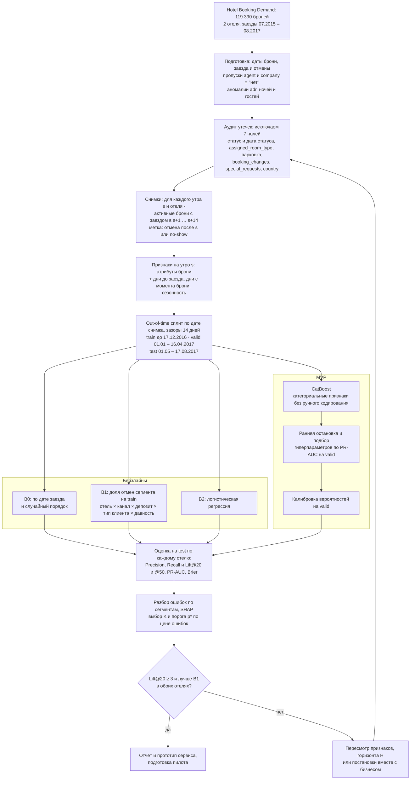
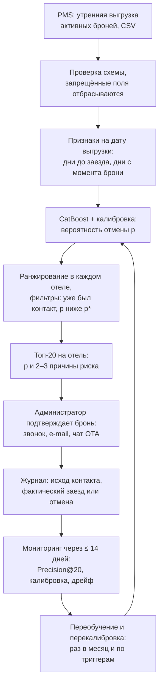

# ML System Design Doc: прогноз риска отмены бронирования отеля

## Дизайн ML-системы "Список броней на подтверждение"

*Все числа о данных воспроизводит команда `make audit` (код - `src/hotel_cancellation/audit.py`).*

- **Проблема.** 37% бронирований в данных заканчиваются отменой или неявкой. Дороже всего поздние потери - отмена за ≤ 7 дней до заезда или номер почти не успеть продать повторно. Это 6 342 брони и ≈ 1,98 млн у.е. выручки за 26 месяцев, или ≈ 76 тыс. у.е. в месяц на два отеля.
- **Продукт.** Каждое утро сервис ранжирует активные брони с заездом в ближайшие 14 дней по вероятности отмены и выдаёт администратору каждого отеля 20 броней, которые стоит подтвердить в первую очередь, - с 2–3 причинами риска.
- **Главный вывод аудита данных.** Среди ещё не отменённых броней с заездом в ближайшие 14 дней будущих отмен лишь 4–5% (тестовый период), а не 37%, т.к. большинство отмен случается за месяцы до заезда. Популярная постановка "предсказать отмену в момент бронирования на случайном сплите" отвечает на другой вопрос и завышает качество. Кроме того, 7 полей датасета заполняются или окончательно фиксируются только при заезде или отмене - это утечки, их исключаем.
- **Метрики.** Precision@20, Recall@20 и Lift@20 для каждого отеля и дня, PR-AUC, калибровка (Brier).
- **Критерий успеха итерации.** На отложенном периоде (май–август 2017) Lift@20 ≥ 3 в каждом отеле, и CatBoost лучше бейзлайна "историческая доля отмен сегмента" по Precision@20 и PR-AUC.

### Термины

| Термин | Значение |
|---|---|
| PMS | Property Management System - система управления отелем, в которой хранятся брони |
| Активная бронь на утро дня s | бронь создана до дня s и не отменена к утру дня s |
| Снимок (snapshot) | бронь в том виде, в каком она видна утром дня s; единица прогноза - пара (бронь, день s) |
| Горизонт H | в список дня s попадают брони с заездом в дни s+1 … s+H; базовое значение - 14 дней |
| Бюджет K | сколько броней администратор успевает подтвердить за смену; базовое значение - 20 на отель |
| Поздняя потеря | отмена за ≤ 7 дней до заезда или no-show |
| No-show | гость не приехал и не отменил бронь |
| ADR | Average Daily Rate - средняя стоимость номера за ночь |
| TA / TO, OTA | турагенты / туроператоры; онлайн-турагентства (Booking.com и др.) |
| Утечка (leakage) | признак, значение которого становится известно только после прогнозируемого события |
| у.е. | денежные единицы ADR в датасете |

---

### 1. Цели и предпосылки

#### 1.1. Зачем идем в разработку продукта?

**Бизнес-цель** `Product Owner`

Сократить потери выручки от поздних отмен и неявок: направить ограниченное время администраторов на подтверждение тех броней, которые с наибольшей вероятностью не состоятся. Если об отмене известно заранее, номер можно вернуть в продажу, предложить гостю перенос дат, запросить гарантию оплаты или учесть ожидаемую отмену в решении об овербукинге.

**Масштаб проблемы** (два отеля, заезды с 01.07.2015 по 31.08.2017):

| | City Hotel | Resort Hotel | Всего |
|---|---:|---:|---:|
| Бронирований | 79 330 | 40 060 | 119 390 |
| Отменено | 32 186 | 10 831 | 43 017 |
| No-show | 916 | 291 | 1 207 |
| Доля потерянных броней | 41,7% | 27,8% | 37,0% |

- Потерянные брони - 16,7 млн у.е. из 42,7 млн забронированной выручки (ADR × число ночей), то есть 39,2%.
- Большинство отмен происходит заранее: медиана - за 56 дней до заезда; в последние 7 дней отменяется только 11,9% от всех отмен, в последние 14 дней - 19,9%. Раннюю отмену отель обычно успевает закрыть новой продажей.
- Поздние потери (отмена за ≤ 7 дней или no-show) - 6 342 брони (14,3% всех потерь) и 1,98 млн у.е., в среднем 313 у.е. на бронь. Именно на этот сегмент может повлиять администратор.

**Как сейчас.** Процесса подтверждения в данных нет, поэтому описываем типовую практику как гипотезу, которую нужно подтвердить с отелем:

- брони подтверждаются без приоритизации: "все заезды на завтра", по порядку дат заезда или выборочно по опыту администратора
- подтвердить всех не получается: в City Hotel в окне 14 дней в среднем 714 активных броней (летом 2017 - 919), то есть каждый день в окно входит ≈ 50–65 новых броней. При 4 минутах на контакт это 3,4–4,4 часа в день, а у администратора есть около часа.
- овербукинг планируется по средней доле отмен, без учёта состава конкретных броней.

**Почему станет лучше с ML** `Product Owner` & `Data Scientist`

- Риск отмены зависит от сочетания факторов: канал продаж, депозит, тип клиента, давность брони, сезон, агент, цена. Простые правила здесь ошибаются.
Пример из данных: по всем броням "чем раньше бронируют, тем чаще отменяют" (ROC-AUC признака `lead_time` = 0,69), но среди броней, доживших до последних 14 дней, зависимость обратная (ROC-AUC = 0,41): давние брони, которые всё ещё не отменены, - самые надёжные, а рискуют свежие.
- Модель упорядочивает брони внутри дневного списка, поэтому при тех же трудозатратах в топ-20 попадает больше будущих отмен, чем при порядке по дате заезда или случайном выборе.
- Откалиброванные вероятности дают и ожидаемое число отмен на каждую дату - вход для решений по овербукингу (вне скоупа MVP).

**Что считаем успехом итерации с точки зрения бизнеса** `Product Owner`

- Офлайн, на отложенном периоде (списки с 01.05 по 17.08.2017): в ежедневном топ-20 каждого отеля будущих отмен минимум в 3 раза больше, чем в случайном списке того же дня (Lift@20 ≥ 3), и больше, чем при ранжировании по исторической доле отмен сегмента (бейзлайн B1).
- Есть прототип: выгрузка броней → список топ-K с вероятностями и причинами риска.
- Есть дизайн пилота с измеримыми метриками и порогами (раздел 3).

#### 1.2. Бизнес-требования и ограничения

**Бизнес-требования** `Product Owner`

| ID | Требование | Приоритет |
|---|---|---|
| БТ-1 | Каждое утро для каждого отеля строится список активных броней с заездом в ближайшие H = 14 дней, упорядоченный по риску отмены или неявки; администратор работает с первыми K = 20 (H и K настраиваются) | Must |
| БТ-2 | Вход - таблица (CSV) из PMS с атрибутами броней на момент выгрузки; выход - таблица с вероятностью, рангом и группой риска и отдельный файл с топ-K | Must |
| БТ-3 | Используется только информация, доступная на момент построения списка; поля, которые заполняются после заезда или отмены, в модель не попадают (проверяется автоматически) | Must |
| БТ-4 | Для каждой брони из топ-K показаны 2–3 понятных фактора риска: "бронь через онлайн-агентство", "без депозита", "создана 3 дня назад" | Should |
| БТ-5 | Вероятности откалиброваны: среди броней с прогнозом ≈ 10% отменяется ≈ 10% | Should |
| БТ-6 | Брони, по которым уже был контакт, не попадают в список повторно | Should |
| БТ-7 | Ранжирование по ожидаемым потерям p × ADR × число ночей как альтернатива ранжированию по вероятности | Could |
| БТ-8 | Одинаковые брони одной группы или агента объединяются в одну строку списка - один контакт | Could |

**Бизнес-ограничения** `Product Owner`

- **Время администратора.** На подтверждения есть около 1–1,5 часа в смену на отель; при 3–5 минутах на контакт это ≈ 20 контактов, отсюда K = 20. Это допущение, его уточняем с отелем.
- **Только "мягкие" действия.** Модель - подсказка человеку: напомнить о брони, уточнить планы, предложить перенос. Автоматическая отмена брони, штраф или требование предоплаты по решению модели недопустимы: цена ложной тревоги для лояльного гостя слишком высока.
- **Каналы связи.** У броней через OTA и туроператоров прямого контакта гостя может не быть - тогда связываемся через канал или агента. Это влияет на скрипт разговора, но не на модель.
- **Данные.** Для MVP есть только публичный датасет: два отеля в Португалии, 2015–2017 годы, до пандемии. Для реального отеля модель обязательно переобучается на его данных, а числа из документа - оценка на исторических данных, а не обещание эффекта.
- **Персональные данные и этика.** В модели нет персональных данных. Страна гостя (`country`) не используется: поле "утекает" (см. 2.3) и могло бы привести к неравному обращению с гостями разных стран.
- **Инфраструктура.** Open-source стек, обучение и инференс на CPU (ноутбук или одна ВМ), без GPU и платных сервисов.

**Цена ошибок и выбор порога**

| Ошибка | Что происходит | Цена |
|---|---|---|
| Ложная тревога (FP): связались с гостем, который приедет | 3–5 минут работы администратора и небольшое неудобство гостя; подтверждение брони - обычная практика отелей | низкая, ≈ 1–3 у.е. |
| Пропуск (FN): будущая отмена или no-show не попали в список | номер может остаться пустым | высокая: в среднем 313 у.е. на позднюю потерю, но контакт спасает лишь часть этой суммы |

Контакт с бронью выгоден, если ожидаемая польза больше его стоимости:

```math
p \cdot u \cdot V > c \quad\Longrightarrow\quad p^{*} = \frac{c}{u \cdot V}
```

Здесь V ≈ 313 у.е. - ценность поздней потери, u - доля этой ценности, которую реально спасает контакт (перепродажа номера, перенос, гарантия; допущение ≈ 0,2), c ≈ 1–3 у.е. - стоимость контакта. Получаем p\* ≈ 1,6–4,8% - порог того же порядка, что и средняя доля отмен в списке (4–5%). Отсюда три вывода:

1. Основное ограничение - бюджет K, поэтому метрики должны оценивать верх списка (Precision@K, Recall@K), а не качество на всей выборке.
2. Порог p\* нужен как отсечка в "тихие" дни: если рискованных броней меньше K, лишние контакты не делаем.
3. u и c - главные неизвестные экономики продукта, их измеряем в пилоте (раздел 3).

**Что ожидаем от итерации** `Product Owner`

1. Обоснованную постановку задачи и аудит данных - этот документ и `make audit`.
2. Модель CatBoost, проверенную офлайн против бейзлайнов на отложенном периоде.
3. Прототип сервиса: выгрузка броней → список топ-K с причинами риска.
4. Дизайн пилота, мониторинга и регламента обновления модели.

**Бизнес-процесс пилота** `Product Owner`

1. Каждое утро до 09:00 из PMS выгружаются активные брони (CSV).
2. Сервис строит признаки на дату выгрузки и выдаёт по каждому отелю топ-20 с вероятностью и причинами риска.
3. Администратор связывается с гостями (телефон, e-mail, мессенджер, чат OTA) по скрипту подтверждения и отмечает исход: подтвердил / отменил / перенёс / не ответил.
4. Отменённые номера сразу возвращаются в продажу; по неответившим из верха списка revenue-менеджер решает, допустим ли овербукинг на эту дату.
5. Исходы контактов и фактические заезды и отмены попадают в журнал - для мониторинга качества и переобучения.

**Что считаем успешным пилотом** `Product Owner`

Модельный список даёт хотя бы вдвое больше "попаданий" (контакт с бронью, которая затем отменилась или не заехала), чем контрольный при том же числе контактов; у броней, с которыми связались, поздних потерь меньше, чем у таких же броней без контакта; жалобы гостей не растут, а нагрузка на администратора остаётся в рамках бюджета. Формальные критерии - в разделе 3. Пути развития после пилота: интеграция с PMS, ранжирование по ожидаемым потерям, прогноз отмен по датам для овербукинга, политика предоплаты для рискованных сегментов.

#### 1.3. Что входит в скоуп проекта/итерации, что не входит

**Закрываем в этой итерации** `Data Scientist`

- БТ-1, БТ-2, БТ-3 - полностью.
- БТ-4 (причины риска через SHAP) и БТ-5 (калибровка) - в базовом виде.
- БТ-7 - офлайн-сравнение ранжирования по p и по p × V, без изменений в продукте.

**Не закрываем** `Data Scientist`

- БТ-6 и БТ-8: нужны журнал контактов и правила группировки броней, они появятся в пилоте.
- Интеграцию с реальной PMS, авторизацию, отказоустойчивость.
- Автоматическую коммуникацию с гостями (рассылки, чат-боты).
- Оптимизацию овербукинга и цен - модель лишь даёт для неё вход.
- Реальный A/B-пилот: у учебного проекта нет отеля-партнёра, поэтому описываем дизайн (раздел 3).
- Обобщение на другие отели и сети, а также прогноз отмены в момент создания брони - это другой продукт (см. 2.1).

**Качество кода и воспроизводимость** `Data Scientist`

- Код - Python-пакет `src/hotel_cancellation`, версии зависимостей зафиксированы в `uv.lock`.
- ruff (линтер и форматер), mypy в строгом режиме, pre-commit-хуки и CI в GitHub Actions на каждый push в `main` и каждый pull request.
- Данные не хранятся в git: `make data` скачивает их из закреплённого коммита и сверяет SHA-256.
- Все числа о данных воспроизводит `make audit`; эксперименты запускаются командами из README с фиксированными random seed.
- Следующим шагом добавляются тесты (pytest) на построение снимков и на отсутствие запрещённых признаков в модели, а также трекинг экспериментов (MLflow).

**Технический долг** `Data Scientist`

- Нет истории изменений брони "на дату", поэтому изменяемые поля (`booking_changes`, `total_of_special_requests`) исключены, хотя в проде их текущие значения доступны.
- Переобучение запускается вручную по регламенту, без оркестратора и feature store.
- Калибровка на одном периоде; мониторинг - регламентный отчёт, а не онлайн-система.
- Интерфейс без авторизации; связь с PMS - через файл CSV.

#### 1.4. Предпосылки решения

`Data Scientist`

| Предпосылка | Решение | Обоснование |
|---|---|---|
| Единица прогноза | пара (бронь, день s): бронь в том виде, в каком она видна утром дня s | список строится ежедневно, а риск брони меняется по мере приближения заезда |
| Кто попадает в список дня s | брони, созданные до дня s, не отменённые к утру s, с заездом в дни s+1 … s+H | ровно те брони, которые администратор может подтвердить; уже отменённые в список попасть не могут |
| Горизонт H | 14 дней; 7 и 30 - в экспериментах | на последние 14 дней приходится 19,9% отмен - самых дорогих; при H = 7 в тестовом периоде в списке всего ≈ 3% будущих отмен, при H = 30 - много ранних отмен, которые и так безвредны; две недели оставляют время перепродать номер |
| Гранулярность | ранжирование отдельно для каждого отеля и дня; одна модель на оба отеля с признаком `hotel` | у отелей свои администраторы и своя доля отмен; общая модель видит больше данных |
| Целевая переменная | 1 - бронь будет отменена (в день s или позже) или гость не приедет; 0 - гость заехал | для отеля поздняя отмена и no-show одинаково оставляют номер пустым |
| Бюджет K | 20 броней на отель в день | время администратора (см. 1.2) |
| Признаки | только известные утром дня s: атрибуты брони, зафиксированные при её создании, и признаки из дат (дни до заезда, дни с момента брони) | БТ-3; список исключённых полей с обоснованием - в 2.3 |
| Валидация | out-of-time по дате снимка, с зазором H дней между частями | модель применяется к будущему; зазор не даёт меткам из следующей части попасть в обучение |
| Пересчёт | скоринг - ежедневно; переобучение - ежемесячно и по триггерам мониторинга | метка созревает не позже чем через H дней, поэтому качество можно проверять еженедельно |
| Данные | Hotel Booking Demand как прототип выгрузки из PMS | другого источника нет; для реального отеля - его история |

Как горизонт H меняет дневной список (среднее на отель в день; значения через "/" - весь период со снимками с 01.07.2015 / тестовый период со снимками с 01.05.2017):

| H, дней | City: броней в списке | City: будущих отмен | City: доля отмен | Resort: броней в списке | Resort: будущих отмен | Resort: доля отмен |
|---:|---:|---:|---:|---:|---:|---:|
| 7 | 367 / 467 | 21,2 / 14,2 | 5,8% / 3,0% | 204 / 221 | 6,8 / 7,2 | 3,4% / 3,3% |
| 14 | 714 / 919 | 59,1 / 44,3 | 8,3% / 4,8% | 385 / 429 | 18,2 / 18,9 | 4,7% / 4,4% |
| 30 | 1 448 / 1 919 | 174,7 / 154,2 | 12,1% / 8,0% | 763 / 877 | 58,7 / 60,1 | 7,7% / 6,9% |

Два следствия: (1) доля будущих отмен в рабочем списке в 5–9 раз ниже, чем по всему датасету; (2) она заметно снижается к 2017 году (City Hotel, H = 14: 8,3% в среднем против 4,8% в тесте), поэтому вероятности придётся перекалибровывать на свежих данных.

---

### 2. Методология `Data Scientist`

#### 2.1. Постановка задачи

**Тип задачи** - бинарная классификация с вероятностным выходом, которая используется для ранжирования с бюджетом (top-K) внутри групп "отель × день".

Для каждой брони i, активной утром дня s в отеле h, модель оценивает вероятность потери брони по признакам x<sub>i</sub>(s), известным на это утро, а список для администратора - это K кандидатов с наибольшей вероятностью среди тех, у кого она не ниже порога p\*:

```math
p_i(s) = P\bigl(y_i = 1 \mid x_i(s)\bigr), \qquad L_K(h, s) = \operatorname{top}_K \bigl\{\, i \in C(h, s) : p_i(s) \ge p^{*} \bigr\}
```

Здесь C(h, s) - кандидаты дня (см. 1.4). Вариант для БТ-7 - ранжирование по p<sub>i</sub>(s) · V<sub>i</sub>, где V<sub>i</sub> = ADR × число ночей.

**Почему не прогноз в момент бронирования.** Это самая популярная постановка для этого датасета: доля отмен 37%, PR-AUC выглядит высоким. Но она отвечает на другой вопрос - "будет ли бронь когда-нибудь отменена". Большинство таких отмен происходит за месяцы до заезда и не требует действий администратора, а при оценке в выборку попадают брони, которые к моменту построения списка уже отменены. Прогноз в момент бронирования полезен для другого продукта - политики предоплаты или овербукинга - и может стать отдельной итерацией.

**Почему не анализ выживаемости (пока).** Модель времени до отмены естественно описывает "живущую" бронь и сразу даёт прогноз на любой горизонт. Это сильный кандидат для следующих итераций, но для MVP классификация на снимках проще, напрямую оптимизирует ежедневный список и легче объясняется бизнесу.

**Метрики качества.** Пусть Y(h, s) - будущие отмены среди кандидатов C(h, s), а S - дни тестового периода. Метрики считаются отдельно для каждого отеля; в Recall@K дни без отмен пропускаются:

```math
\begin{aligned}
\text{Precision@K} &= \frac{1}{|S|}\sum_{s \in S}\frac{|L_K(h,s) \cap Y(h,s)|}{K}, \\
\text{Recall@K} &= \frac{1}{|S|}\sum_{s \in S}\frac{|L_K(h,s) \cap Y(h,s)|}{|Y(h,s)|}, \\
\text{Lift@K} &= \text{Precision@K} \Big/ \frac{1}{|S|}\sum_{s \in S}\frac{|Y(h,s)|}{|C(h,s)|}.
\end{aligned}
```

| Метрика | Зачем | Роль |
|---|---|---|
| Precision@20 | сколько из 20 контактов были "по делу" - продуктивность администратора | основная |
| Recall@20 | какую долю будущих отмен окна видит список; при ≈ 44 отменах в списке City Hotel в тесте потолок Recall@20 ниже 50% | основная |
| Lift@20 | сравнимость отелей и периодов с разной долей отмен; критерий успеха | основная |
| Precision@K и Recall@K для K = 10, 30, 50 | чувствительность к бюджету администратора | вспомогательная |
| PR-AUC (Average Precision) | качество ранжирования без привязки к K; при 4–5% позитивов информативнее ROC-AUC | основная для выбора модели |
| Brier score, калибровочная кривая | честность вероятностей - нужна для порога p\* и прогноза числа отмен | контроль |
| Value@20 | доля "выручки под риском" (ADR × число ночей будущих отмен), попавшей в топ-20, - для БТ-7 | бизнес-прокси |
| ROC-AUC | сравнимость с литературой | справочно |

Accuracy и F1 при пороге 0,5 не используем: при 4–5% позитивов они ничего не говорят о качестве списка.

**Бейзлайны** (подробнее - этап 2 в разделе 2.3):

- **B0 "как сейчас":** порядок по дате заезда (ближайшие - первыми) и случайный порядок как нижняя граница.
- **B1 "доля отмен сегмента":** историческая доля отмен на train в сегменте "отель × канал (`market_segment`) × тип депозита × тип клиента × давность брони" со сглаживанием к общей доле. Такое правило revenue-менеджер может посчитать в Excel.
- **B2:** логистическая регрессия на тех же признаках, что и MVP.

**MVP:** CatBoost на признаках из раздела 2.3 с калибровкой вероятностей на валидации.

#### 2.2. Блок-схема решения

**Схема 1 - обучение и офлайн-оценка.** Бейзлайны и MVP используют общие данные, снимки и протокол оценки и отличаются только блоком модели, поэтому показаны на одной схеме.



**Схема 2 - ежедневная работа сервиса в пилоте и контур обновления модели.**



#### 2.3. Этапы решения задачи

##### Этап 1. Подготовка данных (общий для бейзлайнов и MVP)

**Данные**

| Название данных | Есть ли данные в компании (источник) | Требуемый ресурс для получения | Проверено ли качество |
|---|---|---|---|
| Атрибуты бронирований: 119 390 строк, 32 поля | да - Hotel Booking Demand (Antonio et al., 2019); в проде - выгрузка из PMS | DS; для реального отеля - администратор PMS | да - `make audit`, итоги ниже |
| Итоговый статус брони и дата статуса (для метки и снимков) | да - `reservation_status`, `reservation_status_date` | DS | да: нет отмен позже даты заезда и раньше создания брони; 1 206 из 1 207 no-show датированы днём заезда |
| История изменений брони "на дату" | нет | DE и владелец PMS (журнал изменений) | нет |
| Журнал контактов администратора и их исходов | нет, появится в пилоте | разработка и персонал отеля | нет |
| Справочники агентов и компаний | нет, только анонимные ID (333 агента, 352 компании) | - | - |

**Целевая переменная**

| Название | Определение | Источник | Когда известна |
|---|---|---|---|
| y - бронь будет потеряна | 1, если бронь, активная утром дня s, будет отменена в день s или позже либо гость не приедет; 0 - гость заехал | `reservation_status`, `reservation_status_date` | не позже чем через H дней после s |

**Признаки и аудит утечек** - главный риск этого датасета. Для каждого поля проверяем, известно ли оно утром дня s, а подозрение на утечку подтверждаем данными:

| Группа | Поля | Решение | Обоснование |
|---|---|---|---|
| Известны при создании брони | `hotel`, `lead_time`, `arrival_date_*` (месяц, неделя, день недели), `stays_in_weekend_nights`, `stays_in_week_nights`, `adults`, `children`, `babies`, `meal`, `market_segment`, `distribution_channel`, `customer_type`, `reserved_room_type`, `agent`, `company`, `is_repeated_guest`, `previous_bookings_not_canceled`, `days_in_waiting_list` | используем | по смыслу (см. словарь данных) - атрибуты брони, известные при её создании или подтверждении |
| Известны при создании, но с аномалиями | `deposit_type`, `previous_cancellations`, `adr` | используем; проверяем абляцией и у владельца PMS | `Non Refund` → 99,4% отмен; из 14 587 таких броней 97% - групповые и офлайн-туроператорские, 93% - полные дубликаты, а 1 333 брони одного агента отменены за один день (21.10.2015) - похоже на снятие группового блока. `previous_cancellations > 0` → 91,6% отмен. `adr` у заехавших считается по фактическим начислениям |
| Вычисляются на утро s | дни до заезда, дни с момента брони, день недели снимка, загрузка отеля на дату заезда | используем | считаются только из дат и броней, известных утром s |
| Меняются в течение жизни брони, в данных - только итоговое значение | `booking_changes`, `total_of_special_requests` | исключаем в MVP | `booking_changes` по определению считается "до заезда или отмены"; при наличии изменений отмен 15,7% против 40,9%, при наличии особых запросов - 21,7% против 47,7% |
| Фактически заполняются при заезде | `required_car_parking_spaces`, `assigned_room_type`, `country` | исключаем | при парковке > 0 отмен 0,0% (7 416 броней); если выдан не тот номер, что бронировали, - 5,4% против 41,6%; в сегменте Offline TA/TO у `PRT` 67,8% отмен, у остальных стран - 1,6%: по-видимому, страна по умолчанию - Португалия, а уточняется она на ресепшене |
| Итог брони | `is_canceled`, `reservation_status`, `reservation_status_date` | только для метки и снимков | это и есть прогнозируемое событие |

**Качество данных и обработка**

| Проблема | Масштаб | Обработка |
|---|---|---|
| Пропуски `agent` / `company` | 16 340 / 112 593 | это "нет агента / компании" - отдельная категория |
| Пропуски `country` / `children` | 488 / 4 | `country` не используем; `children` → 0 |
| Категория `Undefined` | `meal` - 1 169, `market_segment` - 2, `distribution_channel` - 5 | `meal`: Undefined = SC (без питания) по словарю данных; в остальных полях - отдельная категория |
| Аномалии `adr` | < 0 - 1, = 0 - 1 959, > 1000 - 1 | отрицательное значение и выброс обрезаем; нулевой ADR (комплиментарные брони) оставляем |
| 0 ночей / 0 гостей | 715 / 180 | оставляем с флагом аномалии, проверяем влияние |
| Полные дубликаты строк | 31 994 (26,8%) | не удаляем: это отдельные номера групповых броней; учитываем при оценке (коррелированные ошибки) и в БТ-8 |
| Доля отмен меняется во времени | в списке H = 14 у City Hotel 8,3% в среднем и 4,8% в тесте | out-of-time валидация, перекалибровка на свежем периоде |

**Out-of-time разбиение снимков** (H = 14, зазоры по 14 дней):

| Часть | Дни снимков | Строк (бронь × день) | Уникальных броней | Доля отмен |
|---|---|---:|---:|---:|
| train | 01.07.2015 – 17.12.2016 | 564 158 | 49 543 | 7,8% |
| valid | 01.01.2017 – 16.04.2017 | 113 164 | 10 993 | 6,5% |
| test | 01.05.2017 – 17.08.2017 | 146 921 | 13 161 | 4,7% |

**Результат этапа:** таблица снимков с признаками, меткой и разбиением (parquet); контракт входных данных сервиса (список полей и типов); отчёт об аудите данных и утечек.

##### Этап 2. Бейзлайны

- **Выборка и валидация** - как в этапе 1; у бейзлайнов нет гиперпараметров, кроме сглаживания в B1 и регуляризации в B2, их выбираем на valid.
- **Техника:** B0 - порядок по дате заезда и случайный; B1 - доля отмен сегмента (см. 2.1), сегменты меньше 30 снимков сливаются с родительским уровнем; B2 - логистическая регрессия (one-hot для категорий, стандартизация числовых признаков, L2-регуляризация).
- **Метрики** - все из раздела 2.1, по каждому отелю, на valid и test.
- **Ожидаемый результат:** B1 и B2 заметно лучше случайного порядка - в данных есть сегменты с высокой долей отмен, - но хуже модели, которая учитывает взаимодействия признаков. Бейзлайны задают планку для критерия успеха и заодно проверяют код оценки.
- **Риск:** если B2 почти не уступает CatBoost, выбираем более простую и прозрачную модель.

##### Этап 3. MVP-модель (CatBoost)

- **Почему CatBoost:** много категориальных признаков, в том числе с сотнями значений (`agent` - 333, `company` - 352). CatBoost кодирует их сам упорядоченными целевыми статистиками, которые снижают переобучение; у него сильные настройки по умолчанию на табличных данных, быстрое обучение и инференс на CPU и встроенные SHAP-значения для БТ-4. Альтернативы - LightGBM или XGBoost (нужно отдельное кодирование категорий) и B2.
- **Выборка:** все снимки train-периода - 564 тыс. строк; каждая бронь встречается до 14 раз, в разные дни.
- **Дисбаланс:** обучаем на естественном распределении, без undersampling, чтобы вероятности оставались осмысленными; веса классов - только как эксперимент с последующей перекалибровкой.
- **Подбор:** `depth` 4–8, `learning_rate` 0,03–0,1, `l2_leaf_reg` 1–10, до 3 000 итераций с ранней остановкой по PR-AUC на valid; небольшой перебор (сетка или Optuna, не больше 30 запусков) с фиксированным seed.
- **Калибровка:** isotonic или Platt на valid (выбор по Brier), так как доля отмен меняется между периодами: 7,8% в train, 6,5% в valid, 4,7% в test.
- **Устойчивость:** rolling-origin бэктест на трёх окнах (сентябрь–декабрь 2016, январь–апрель 2017, май–август 2017) - среднее и разброс метрик; доверительные интервалы bootstrap по дням.
- **Абляции для отчёта:** (а) добавить `country`, `booking_changes`, `total_of_special_requests`, чтобы показать, насколько утечки завышают метрики; (б) H = 7, 14, 30; (в) модель без `deposit_type` и `previous_cancellations`.
- **Необходимый результат этапа:** выполнен критерий успеха из раздела 1.1; в модели нет запрещённых полей (автотест); по Brier вероятности не хуже B1; главные факторы по SHAP объяснимы с точки зрения бизнеса.
- **Риски и что делаем:**
  - легальных признаков мало и сигнал слабый → признаки "на дату" (доля прошлых отмен агента к утру s, размер группы одинаковых броней, загрузка отеля на дату заезда), пересмотр H, а при неудаче - пересмотр продукта вместе с бизнесом;
  - одна бронь даёт до 14 почти одинаковых строк, и целевые статистики CatBoost по редким категориям могут "запомнить" метку → редкие `agent` и `company` (меньше 50 броней) объединяем в "прочие", следим за разрывом train/valid, пробуем веса 1/(число снимков брони);
  - массовые отмены групп делают дневные метрики шумными → интервалы bootstrap по дням, разбор ошибок по группам.
- **Бизнес-проверка:** см. этап 4.

##### Этап 4. Интерпретация и бизнес-правила

- SHAP-значения каждой брони → 2–3 главных фактора, переведённых в понятные фразы по словарю шаблонов.
- Выбор K и порога p\*: таблица Precision@K, Recall@K и Value@K для K = 10, 20, 30, 50 и расчёт p\* при разных c и u (см. 1.2).
- Сравнение ранжирования по p и по p × V (БТ-7).
- Бизнес-проверка: разбор 3–5 дневных списков с практиком из отеля (в учебном проекте - с ментором или одногруппниками): "стали бы вы звонить этим гостям?", понятны ли причины риска.

##### Этап 5. Прототип сервиса

- CLI и простой веб-интерфейс (Streamlit): загрузка CSV → проверка схемы (обязательные поля и типы; запрещённые поля отбрасываются с предупреждением) → признаки на дату выгрузки → скоринг и калибровка → топ-K по отелям с причинами → выгрузка CSV.
- Тесты: построение снимков на синтетических бронях (отменённая до дня s бронь не попадает в список, метка верна), "чёрный список" полей модели, смоук-тест скоринга.
- Результат: прототип и инструкция в README.

##### Этап 6. Отчёт для бизнеса

Метрики против бейзлайнов по отелям и сезонам, примеры списков с причинами риска, оценка эффекта при явных допущениях (c, u, V) и рекомендации к пилоту.

---

### 3. Подготовка пилота

#### 3.1. Способ оценки пилота

Пилот отвечает на два вопроса: (1) находит ли модельный список больше будущих отмен на один контакт, чем текущая практика; (2) уменьшает ли сам контакт поздние потери. `Product Owner`, `Data Scientist`

- **Длительность:** 8 недель в обоих отелях.
- **Рандомизация по броням:** при первом попадании в окно бронь по хэшу `booking_id` относится к группе M (модель) или C (контроль) в пропорции 50/50.
- **Ежедневный список:** администратор получает 10 броней группы M с наибольшим p и 10 броней группы C по текущему правилу (ближайший заезд - первым). Брони перемешаны в одном списке, администратор не знает, из какой группы бронь.
- **Holdout:** 20% броней, выбранных в каждой группе, случайно оставляем без контакта - чтобы измерить эффект самого контакта.
- **Логирование:** исход контакта и время на него, итог брони (заезд / отмена / no-show) и дата отмены, перепродажа номера.

| Метрика | Определение | Тип |
|---|---|---|
| Hit rate | доля контактов, после которых бронь отменилась (в том числе во время разговора) или гость не приехал | основная, M против C |
| Поздние потери | номеро-ночи, потерянные из-за no-show и отмен за ≤ 7 дней, на 100 выбранных броней: с контактом против holdout | вторичная - эффект контакта |
| Перепродажа | доля номеров, освобождённых после контакта и проданных снова | вторичная |
| Нагрузка | время на подтверждения за смену | guardrail |
| Недовольство гостей | жалобы и негативные отзывы, связанные с контактами | guardrail |

**Размер выборки.** Чтобы с α = 0,05 и мощностью 0,8 отличить hit rate 10% от 5% (двукратная разница), нужно ≈ 430 контактов в каждой группе. При 10 выбранных бронях в день на группу в каждом из двух отелей и 20% holdout это ≈ 16 контактов в день на группу, то есть ≈ 4 недели. 8 недель дают двойной запас и покрывают недельную сезонность. Эффект самого контакта требует бо́льшей выборки: при holdout 20% он оценивается с широким интервалом, поэтому после пилота остаётся постоянная контрольная группа (см. 4.8).

**Анализ:** сравнение долей (z-тест) и bootstrap по дням; результаты - отдельно по отелям, общий вывод - по сумме.

#### 3.2. Что считаем успешным пилотом

`Product Owner`

- **Основной критерий:** hit rate группы M ≥ 2 × hit rate группы C; разница статистически значима (α = 0,05) по сумме отелей и не отрицательна в каждом отеле.
- **Вторичный критерий:** поздние потери у броней M с контактом ниже, чем у броней M из holdout (точечная оценка и интервал), - основа для расчёта экономического эффекта.
- **Guardrails:** в среднем ≤ 1,5 часа на подтверждения в смену; жалоб гостей не больше, чем за 8 недель до пилота; список готов к 09:00 не менее чем в 95% дней.
- **Экономика:** предотвращённые поздние потери × V × доля перепродажи − стоимость времени администратора > 0 в пересчёте на месяц.

#### 3.3. Подготовка пилота

`Data Scientist`

- **Вычисления:** обучение - ≈ 0,6–1 млн строк × ≈ 30 признаков, CatBoost на CPU справляется за минуты; ежедневный скоринг 1–3 тыс. броней занимает меньше секунды. Хватает ноутбука или ВМ на 2 vCPU / 4 ГБ, GPU не нужен. Ограничения для модели: размер < 100 МБ, скоринг 10 тыс. строк < 10 с.
- **До старта:** переобучить и откалибровать модель на истории конкретного отеля (не меньше 12 месяцев, обязательно с датами отмен); сверить выгрузку PMS с контрактом данных; согласовать скрипт подтверждения и коды исходов; завести журнал контактов; провести 30-минутное обучение администраторов; проверить процедуру рандомизации.
- **Fallback:** если сервис недоступен, администратор работает по прежнему правилу, а день отмечается в журнале.

---

### 4. Внедрение

> Для MVP раздел описывает целевую схему пилота. Прототип этой итерации - CLI и Streamlit без интеграций.

#### 4.1. Архитектура решения

- **Пакет `hotel_cancellation`:** данные → снимки и признаки → модель и калибратор → объяснения → список.
- **Пакетный скоринг (CLI):** `score --input export.csv --as-of 2017-06-01 --k 20 --output list.csv`.
- **Веб-интерфейс (Streamlit):** загрузка выгрузки, просмотр списка, скачивание CSV, отметка исхода контакта.
- **Артефакты модели:** файл CatBoost (`.cbm`), калибратор и метаданные (список признаков, период обучения, метрики, версия данных); на следующих итерациях - MLflow Model Registry.
- **Журнал контактов:** SQLite на время пилота.
- **Развитие:** REST API на FastAPI - `POST /v1/lists` (брони, дата и K → ранжированный список с p и причинами), `GET /v1/model` (версия, период обучения, метрики), `GET /health`; плановая загрузка выгрузок из PMS.

#### 4.2. Описание инфраструктуры и масштабируемости

- **Выбор:** один Docker-контейнер (Streamlit, модель, SQLite) на ВМ или офисном сервере отеля.
- **Плюсы:** дёшево, просто развернуть и поддерживать, нет зависимости от облачных сервисов.
- **Минусы:** нет отказоустойчивости, обновления вручную; для сети отелей понадобятся отдельные API и хранилище.
- **Почему лучше альтернатив:** решение принимается раз в день по 1–3 тыс. броней, поэтому real-time API, стриминг и облачные ML-платформы избыточны и дороже. Переход на сервис FastAPI с планировщиком - когда подключается несколько отелей.

#### 4.3. Требования к работе системы

- Список готов ежедневно к 09:00 по местному времени.
- Скоринг 10 тыс. броней - не дольше 10 с, отклик интерфейса - не дольше 3 с.
- Доступность в утреннюю смену - не менее 95% дней; при сбое работает прежний процесс.
- Переобучение и калибровка - не дольше 30 минут на CPU.

#### 4.4. Безопасность системы

- Загружаются только CSV с ограничением размера и проверкой схемы; данные пользователя не исполняются (никаких `pickle` и `eval`).
- Модель загружается только из доверенного хранилища и в формате CatBoost, а не `pickle`.
- Интерфейс доступен во внутренней сети отеля и закрыт авторизацией.
- Версии зависимостей зафиксированы (`uv.lock`) и обновляются по регламенту; секреты не хранятся в репозитории (хук `detect-private-key`, `.env` в `.gitignore`).

#### 4.5. Безопасность данных

- Датасет анонимизирован и распространяется по лицензии CC BY 4.0.
- В проде выгрузка PMS содержит персональные данные (имя, телефон, e-mail), поэтому сервис принимает только белый список полей модели и `booking_id`; контакты гостей остаются в PMS; журналы ведутся без персональных данных и хранятся не дольше года.
- Для отелей в ЕС действует GDPR, в России - 152-ФЗ. Вероятные основания обработки - исполнение договора (подтверждение брони) и законный интерес (оценка риска); решения с юридическими последствиями автоматически не принимаются (ст. 22 GDPR) - решает человек; национальность не используется.

#### 4.6. Издержки

- Инфраструктура: ВМ 2 vCPU / 4 ГБ - порядка 10–20 у.е. в месяц, либо существующий сервер отеля.
- Основная статья - время администратора: 20 контактов × 4 минуты ≈ 1,3 часа в день на отель.
- Поддержка: ежемесячное переобучение и отчёт - 2–4 часа работы DS в месяц.

#### 4.7. Integration points

| Откуда → куда | Что передаётся | Как |
|---|---|---|
| PMS → сервис | активные брони на утро (поля из контракта данных) | CSV: сначала вручную, затем по расписанию (SFTP или API PMS) |
| Сервис → администратор | топ-K по отелю: `booking_id`, p, ранг, причины | экран Streamlit и CSV |
| Администратор → журнал | исход контакта, время, комментарий | форма в интерфейсе |
| PMS → журнал | итог брони (заезд / отмена / no-show) и его дата | ежедневная выгрузка |
| Журнал → обучение | размеченные снимки и флаги контакта | ежемесячная сборка датасета |
| Сервис → revenue-менеджер (развитие) | ожидаемое число отмен на каждую дату | отчёт |

#### 4.8. Мониторинг и обновление модели

Метка созревает не позже чем через H = 14 дней, поэтому качество проверяется по спискам двухнедельной давности:

| Что | Как | Порог и реакция |
|---|---|---|
| Качество списка | Precision@20, Recall@20, Lift@20 по каждому отелю - еженедельно | Lift@20 < 2 две недели подряд → разбор и внеплановое переобучение |
| Калибровка | средняя p против фактической доли отмен в списке, Brier | относительное расхождение > 30% → перекалибровка |
| Дрейф данных | PSI для `lead_time`, `adr`, дней с момента брони, долей `market_segment`, `distribution_channel`, `deposit_type`; доля новых `agent` | PSI > 0,2 → анализ и переобучение |
| Входной файл | схема, пропуски, неизвестные категории | ошибка схемы → список не строится, работает fallback |
| Использование | доля обработанных броней из топ-K, время на контакт | обработано меньше 70% → разбор с отелем |

**Регламент обновления**

- **Плановое переобучение** - раз в месяц на скользящем окне последних 24 месяцев, чтобы модель видела годовую сезонность; перекалибровка - на последних 1–2 месяцах.
- **Внеплановое переобучение** - по порогам мониторинга.
- **Выкатка:** новая модель (challenger) сравнивается с текущей (champion) на последних 4 неделях созревших списков по Precision@20 и Brier и заменяет её, только если не хуже; предыдущая версия хранится для отката.
- **Петля обратной связи.** Контакт меняет исход брони: гость после звонка может отменить раньше или, наоборот, остаться. Чтобы не обучаться на искажённых метках, флаг контакта сохраняется в журнале, а после пилота остаётся постоянная контрольная группа - ≈ 10% выбранных броней без контакта - для честной оценки качества и эффекта.

#### 4.9. Риски

| Риск | Вероятность | Влияние | Что делаем |
|---|---|---|---|
| После исключения утечек сигнал слабый, модель ненамного лучше правил | средняя | высокое | честные бейзлайны и критерий go/no-go (Lift@20 ≥ 3); признаки "на дату"; пересмотр H или продукта |
| Неочевидные утечки в `deposit_type`, `previous_cancellations`, `adr` | средняя | высокое | абляции, сверка смысла полей с владельцем PMS, автотест "чёрного списка" полей |
| Сдвиг данных: 2015–2017 годы, Португалия, до пандемии | высокая | высокое | переобучение на данных конкретного отеля, мониторинг дрейфа |
| Массовые отмены групп: шумные метрики, одна группа "забивает" список | высокая | среднее | интервалы bootstrap по дням, разбор по группам, БТ-8 |
| Петля обратной связи искажает метки | высокая после внедрения | среднее | журнал контактов, постоянная контрольная группа |
| Администраторы не пользуются списком | средняя | высокое | понятные причины риска, короткий список, обучение, сбор обратной связи |
| Гостей раздражают звонки | низкая | среднее | мягкий скрипт, удобный гостю канал, guardrail по жалобам |
| Неравное обращение с гостями разных стран | низкая | высокое | `country` исключён; проверка состава списков по сегментам |

---

### Приложение А. Как воспроизвести числа

```bash
make data    # скачать датасет в data/raw/ и проверить SHA-256
make audit   # вывести все факты о данных, которые используются в документе
```

Разделы вывода `make audit`: доля потерь по отелям; качество данных; когда теряются брони и сколько выручки под риском; доказательства утечек; размеры дневных списков для H = 7, 14, 30; разбиение train/valid/test; ROC-AUC отдельных признаков.

### Приложение Б. Источники

1. Antonio N., de Almeida A., Nunes L. Hotel booking demand datasets // Data in Brief. 2019. Vol. 22. P. 41–49. <https://doi.org/10.1016/j.dib.2018.11.126> (CC BY 4.0).
2. TidyTuesday, 2020-02-11, "Hotels" - копия датасета и словарь данных: <https://github.com/rfordatascience/tidytuesday/tree/main/data/2020/2020-02-11>
3. Шаблон ML System Design Doc [RU] от Reliable ML: <https://github.com/IrinaGoloshchapova/ml_system_design_doc_ru>
4. Prokhorenkova L. et al. CatBoost: unbiased boosting with categorical features // NeurIPS. 2018. <https://arxiv.org/abs/1706.09516>
