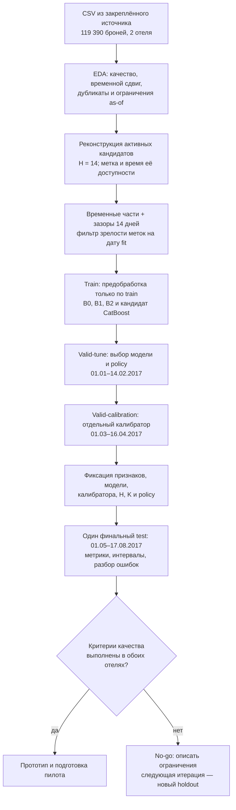
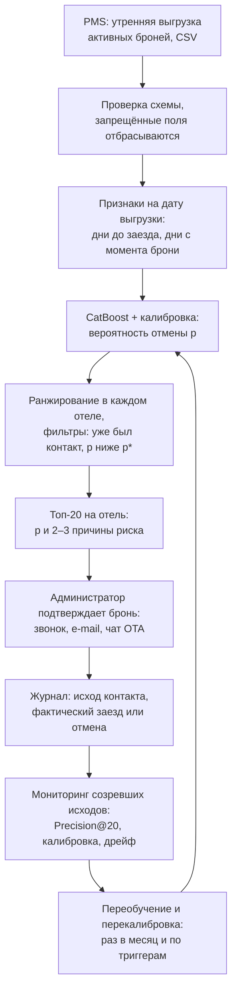

# ML System Design Doc: прогноз риска отмены бронирования отеля

## Дизайн ML-системы "Список броней на подтверждение"

- **Проблема.** 37% бронирований в данных заканчиваются отменой или неявкой. Наиболее интересны для подтверждения поздние отмены (за ≤ 7 дней до заезда) и no-show: номер сложнее продать повторно. Это 6 342 брони и ≈ 1,98 млн у.е. стоимости бронирований за 26 месяцев, или ≈ 76 тыс. у.е. в месяц на два отеля. Это прокси выручки под риском, а не измеренный убыток: данных о возвратах, штрафах и перепродаже нет.
- **Продукт.** Каждое утро сервис ранжирует активные брони с заездом в ближайшие 14 дней по вероятности отмены и выдаёт администратору каждого отеля 20 броней, которые стоит подтвердить в первую очередь, - с 2–3 причинами риска.
- **Главный вывод аудита данных.** Среди ещё не отменённых броней с заездом в ближайшие 14 дней будущих отмен лишь 4–5% (тестовый период), а не 37%, т.к. большинство отмен случается за месяцы до заезда. Постановка "предсказать отмену в момент бронирования" отвечает на другой вопрос. Для нашего продукта нужны временная валидация и значения признаков на дату прогноза, CSV не содержит полной истории изменений, поэтому реконструированные снимки остаются приближением даже после исключения подозрительных полей.
- **Метрики.** Precision@20, Recall@20 и Lift@20 для каждого отеля и дня, PR-AUC, калибровка (Brier).
- **Критерий успеха итерации.** На отложенном периоде (май–август 2017) Lift@20 ≥ 3 в каждом отеле, и выбранная модель лучше бейзлайна "историческая доля отмен сегмента" по Precision@20 и PR-AUC.

### Термины

| Термин | Значение |
|---|---|
| PMS | Property Management System - система управления отелем, в которой хранятся брони |
| Активная бронь на утро дня s | бронь создана до дня s и не отменена к утру дня s |
| Снимок (snapshot) | целевое состояние брони на утро s; в CSV — ретроспективная реконструкция с ограничениями; единица прогноза — пара (бронь, день s) |
| Горизонт H | в список дня s попадают брони с заездом в дни s+1 … s+H; базовое значение - 14 дней |
| Бюджет K | сколько броней администратор успевает подтвердить за смену; базовое значение - 20 на отель |
| Поздняя потеря | отмена за ≤ 7 дней до заезда или no-show |
| No-show | гость не приехал и не отменил бронь |
| ADR | Average Daily Rate - средняя стоимость номера за ночь |
| TA / TO, OTA | турагенты / туроператоры; онлайн-турагентства (Booking.com и др.) |
| Утечка (leakage) | использование информации, недоступной на момент прогноза, включая будущие значения признаков или метку |
| у.е. | денежные единицы ADR в датасете |

---

### 1. Цели и предпосылки

#### 1.1. Зачем идем в разработку продукта?

**Бизнес-цель** `Product Owner`

Сократить потери выручки от поздних отмен и неявок: направить ограниченное время администраторов на подтверждение тех броней, которые с наибольшей вероятностью не состоятся. Если об отмене известно заранее, номер можно вернуть в продажу, предложить гостю перенос дат, запросить гарантию оплаты или учесть ожидаемую отмену в решении об овербукинге.

**Масштаб проблемы** (два отеля, заезды с 01.07.2015 по 31.08.2017):

| | City Hotel | Resort Hotel | Всего |
|---|---:|---:|---:|
| Бронирований | 79 330 | 40 060 | 119 390 |
| Отменено | 32 186 | 10 831 | 43 017 |
| No-show | 916 | 291 | 1 207 |
| Доля потерянных броней | 41,7% | 27,8% | 37,0% |

- Стоимость отменённых броней — 16,7 млн у.е. из 42,7 млн общей стоимости (max(ADR, 0) × число ночей), то есть 39,2%. Это выручка под риском до учёта штрафов, возвратов и перепродажи.
- Большинство отмен происходит заранее: медиана - за 56 дней до заезда; в последние 7 дней отменяется только 11,9% от всех отмен, в последние 14 дней - 19,9%. Гипотеза бизнеса: раннюю отмену легче закрыть новой продажей; в CSV перепродажа не наблюдается.
- Поздние потери (отмена за ≤ 7 дней или no-show) - 6 342 брони (14,3% всех потерь) и 1,98 млн у.е. стоимости, в среднем 313 у.е. на бронь. Возможность влияния администратора на этот сегмент — гипотеза для пилота.

**Как сейчас.** Процесса подтверждения в данных нет, поэтому описываем типовую практику как гипотезу, которую нужно подтвердить с отелем:

- брони подтверждаются без приоритизации: "все заезды на завтра", по порядку дат заезда или выборочно по опыту администратора
- подтвердить всех не получается: в City Hotel в окне 14 дней в среднем 714 активных броней (летом 2017 - 919), деление размера окна на H даёт грубый ориентир ≈ 50–65 броней в день, но не измеряет фактический приток кандидатов. При 4 минутах на контакт это 3,4–4,4 часа в день, а у администратора есть около часа.
- овербукинг планируется по средней доле отмен, без учёта состава конкретных броней.

**Почему станет лучше с ML** `Product Owner` & `Data Scientist`

- Риск отмены зависит от сочетания факторов: канал продаж, депозит, тип клиента, давность брони, сезон, агент, цена. Простые правила здесь ошибаются.
Пример из данных: по всем броням "чем раньше бронируют, тем чаще отменяют" (ROC-AUC признака `lead_time` = 0,69), но среди броней, доживших до последних 14 дней, зависимость обратная (ROC-AUC = 0,41): в рабочей выборке более давняя бронь связана с меньшей долей потерь; это ассоциация, а не причинный эффект.
- Гипотеза: модель упорядочит брони так, что при тех же трудозатратах в топ-20 попадёт больше будущих отмен, чем при порядке по дате заезда или случайном выборе. Проверяем это против бейзлайнов.
- Откалиброванные вероятности дают и ожидаемое число отмен на каждую дату - вход для решений по овербукингу (вне скоупа MVP).

**Что считаем успехом итерации с точки зрения бизнеса** `Product Owner`

- Офлайн, на отложенном периоде (списки с 01.05 по 17.08.2017): макроусреднённая по дням точность топ-20 каждого отеля минимум втрое выше средней дневной доли отмен (Lift@20 ≥ 3), и больше, чем при ранжировании по исторической доле отмен сегмента (бейзлайн B1).
- Есть прототип: выгрузка броней → список топ-K с вероятностями и причинами риска.
- Есть дизайн пилота с измеримыми метриками и порогами (раздел 3).

#### 1.2. Бизнес-требования и ограничения

**Бизнес-требования** `Product Owner`

| ID | Требование | Приоритет |
|---|---|---|
| БТ-1 | Каждое утро для каждого отеля строится список активных броней с заездом в ближайшие H = 14 дней, упорядоченный по риску отмены или неявки; администратор работает с первыми K = 20 (H и K настраиваются) | Must |
| БТ-2 | Вход - таблица (CSV) из PMS с атрибутами броней на момент выгрузки; выход - таблица с вероятностью, рангом и группой риска и отдельный файл с топ-K | Must |
| БТ-3 | Используется только информация, доступная на момент построения списка; поля, которые заполняются после заезда или отмены, в модель не попадают (проверяется автоматически) | Must |
| БТ-4 | Для каждой брони из топ-K показаны 2–3 понятных фактора риска: "бронь через онлайн-агентство", "без депозита", "создана 3 дня назад" | Should |
| БТ-5 | Вероятности откалиброваны: среди броней с прогнозом ≈ 10% отменяется ≈ 10% | Should |
| БТ-6 | Брони, по которым уже был контакт, не попадают в список повторно | Should |
| БТ-7 | Ранжирование по ожидаемым потерям p × ADR × число ночей как альтернатива ранжированию по вероятности | Could |
| БТ-8 | Одинаковые брони одной группы или агента объединяются в одну строку списка - один контакт | Could |

**Бизнес-ограничения** `Product Owner`

- **Время администратора.** На подтверждения есть около 1–1,5 часа в смену на отель; при 3–5 минутах на контакт это ≈ 20 контактов, отсюда K = 20. Это допущение, его уточняем с отелем.
- **Только "мягкие" действия.** Модель - подсказка человеку: напомнить о брони, уточнить планы, предложить перенос. Автоматическая отмена брони, штраф или требование предоплаты по решению модели недопустимы: цена ложной тревоги для лояльного гостя слишком высока.
- **Каналы связи.** У броней через OTA и туроператоров прямого контакта гостя может не быть - тогда связываемся через канал или агента. Это влияет на скрипт разговора, но не на модель.
- **Данные.** Для MVP есть только публичный датасет: два отеля в Португалии, 2015–2017 годы, до пандемии. Для реального отеля модель обязательно переобучается на его данных, а числа из документа - оценка на исторических данных, а не обещание эффекта.
- **Персональные данные и этика.** В публичном CSV нет имён и контактов гостей. `country` исключён из-за неопределённого времени уточнения и риска неравного обращения с гостями разных стран. Для реальных выгрузок нужны отдельные правила доступа и обработки (этап 1).
- **Инфраструктура.** Open-source стек, обучение и инференс на CPU (ноутбук или одна ВМ), без GPU и платных сервисов.

**Цена ошибок и выбор порога**

| Ошибка | Что происходит | Цена |
|---|---|---|
| Ложная тревога (FP): связались с гостем, который приедет | 3–5 минут работы администратора и небольшое неудобство гостя; подтверждение брони - обычная практика отелей | низкая, ≈ 1–3 у.е. |
| Пропуск (FN): будущая отмена или no-show не попали в список | номер может остаться пустым | высокая: в среднем 313 у.е. на позднюю потерю, но контакт спасает лишь часть этой суммы |

Контакт с бронью выгоден, если ожидаемая польза больше его стоимости:

```math
p \cdot u \cdot V > c \quad\Longrightarrow\quad p^{*} = \frac{c}{u \cdot V}
```

Здесь V ≈ 313 у.е. - ценность поздней потери, u - доля этой ценности, которую реально спасает контакт (перепродажа номера, перенос, гарантия; допущение ≈ 0,2), c ≈ 1–3 у.е. - стоимость контакта. Получаем p\* ≈ 1,6–4,8% - порог того же порядка, что и средняя доля отмен в списке (4–5%). Отсюда три вывода:

1. Основное ограничение - бюджет K, поэтому метрики должны оценивать верх списка (Precision@K, Recall@K), а не качество на всей выборке.
2. Порог p\* нужен как отсечка в "тихие" дни: если рискованных броней меньше K, лишние контакты не делаем.
3. u и c - главные неизвестные экономики продукта, их измеряем в пилоте (раздел 3).

**Что ожидаем от полной MVP-итерации** `Product Owner`

1. Обоснованную постановку задачи и аудит данных - этот документ и `make audit`.
2. Выбранную по сравнению модель (кандидат CatBoost), проверенную офлайн против бейзлайнов.
3. Прототип сервиса: выгрузка броней → список топ-K с причинами риска.
4. Дизайн пилота, мониторинга и регламента обновления модели.

**Бизнес-процесс пилота** `Product Owner`

1. Каждое утро до 09:00 из PMS выгружаются активные брони (CSV).
2. Сервис строит признаки на дату выгрузки и выдаёт по каждому отелю топ-20 с вероятностью и причинами риска.
3. Администратор связывается с гостями (телефон, e-mail, мессенджер, чат OTA) по скрипту подтверждения и отмечает исход: подтвердил / отменил / перенёс / не ответил.
4. Отменённые номера сразу возвращаются в продажу; по неответившим из верха списка revenue-менеджер решает, допустим ли овербукинг на эту дату.
5. Исходы контактов и фактические заезды и отмены попадают в журнал - для мониторинга качества и переобучения.

**Что считаем успешным пилотом** `Product Owner`

Модельный список даёт хотя бы вдвое больше "попаданий" (контакт с бронью, которая затем отменилась или не заехала), чем контрольный при том же числе контактов; у броней, с которыми связались, поздних потерь меньше, чем у таких же броней без контакта; жалобы гостей не растут, а нагрузка на администратора остаётся в рамках бюджета. Формальные критерии - в разделе 3. Пути развития после пилота: интеграция с PMS, ранжирование по ожидаемым потерям, прогноз отмен по датам для овербукинга, политика предоплаты для рискованных сегментов.

#### 1.3. Что входит в скоуп проекта/итерации, что не входит

**Целевой скоуп MVP** `Data Scientist`

- БТ-1, БТ-2, БТ-3 - полностью.
- БТ-4 (причины риска через SHAP) и БТ-5 (калибровка) - в базовом виде.
- БТ-7 - офлайн-сравнение ранжирования по p и по p × V, без изменений в продукте.

**Не закрываем** `Data Scientist`

- БТ-6 и БТ-8: нужны журнал контактов и правила группировки броней, они появятся в пилоте.
- Интеграцию с реальной PMS, авторизацию, отказоустойчивость.
- Автоматическую коммуникацию с гостями (рассылки, чат-боты).
- Оптимизацию овербукинга и цен - модель лишь даёт для неё вход.
- Реальный A/B-пилот: у учебного проекта нет отеля-партнёра, поэтому описываем дизайн (раздел 3).
- Обобщение на другие отели и сети, а также прогноз отмены в момент создания брони - это другой продукт (см. 2.1).

**Качество кода и воспроизводимость** `Data Scientist`

- Код - Python-пакет `src/hotel_cancellation`, версии зависимостей зафиксированы в `uv.lock`.
- ruff (линтер и форматер), mypy в строгом режиме, pre-commit-хуки и CI в GitHub Actions на каждый push в `main` и каждый pull request.
- Данные не хранятся в git: `make data` скачивает их из закреплённого коммита и сверяет SHA-256.
- Числа о данных воспроизводят `make audit` и `make eda`; агрегаты детерминированы для закреплённого файла. Команды для запуска с нуля - в разделе "Как запустить" [README](../README.md#как-запустить).
- Эксперименты следующих этапов (бейзлайны, CatBoost) будут запускаться командами из того же раздела README с фиксированным random seed.
- Добавлены тесты stdlib unittest на границы снимков, временные части и зрелость меток (`make test`). При реализации моделей добавятся проверки разрешённых признаков и трекинг экспериментов.

**Технический долг** `Data Scientist`

- Нет истории изменений брони "на дату", поэтому изменяемые поля (`booking_changes`, `total_of_special_requests`) исключены, хотя в проде их текущие значения доступны.
- Переобучение запускается вручную по регламенту, без оркестратора и feature store.
- Калибровка на одном периоде; мониторинг - регламентный отчёт, а не онлайн-система.
- Интерфейс без авторизации; связь с PMS - через файл CSV.

#### 1.4. Предпосылки решения

`Data Scientist`

| Предпосылка | Решение | Обоснование |
|---|---|---|
| Единица прогноза | пара (бронь, день s): бронь в том виде, в каком она видна утром дня s | список строится ежедневно, а риск брони меняется по мере приближения заезда |
| Кто попадает в список дня s | брони, созданные до дня s, не отменённые к утру s, с заездом в дни s+1 … s+H | ровно те брони, которые администратор может подтвердить; уже отменённые в список попасть не могут |
| Горизонт H | 14 дней; 7 и 30 - в экспериментах | на последние 14 дней приходится 19,9% отмен; они потенциально труднее для перепродажи; при H = 7 в тестовом периоде в списке всего ≈ 3% будущих отмен, при H = 30 в список включаются более ранние отмены; две недели оставляют время перепродать номер |
| Гранулярность | ранжирование отдельно для каждого отеля и дня; одна модель на оба отеля с признаком `hotel` | у отелей свои администраторы и своя доля отмен; общая модель видит больше данных |
| Целевая переменная | 1 - бронь будет отменена (в день s или позже) или гость не приедет; 0 - гость заехал | для отеля поздняя отмена и no-show одинаково оставляют номер пустым |
| Бюджет K | 20 броней на отель в день | время администратора (см. 1.2) |
| Признаки | целевое требование: значения, известные утром дня s; CSV даёт лишь приближение | БТ-3; ограничения источника и список исключений — в 2.3 |
| Валидация | out-of-time по дате снимка, зазор H дней и проверка доступности метки | зазор исключает пересечение снимков одной брони, но не гарантирует зрелость Check-Out |
| Пересчёт | скоринг — ежедневно; переобучение — ежемесячно и по триггерам | качество считаем по созревшим исходам; задержку поступления статусов контролируем отдельно |
| Данные | Hotel Booking Demand как прототип выгрузки из PMS | другого источника нет; для реального отеля - его история |

Как горизонт H меняет дневной список (описание доступных окон, не строгое сравнение моделей; среднее на отель в день; значения через "/" - весь период со снимками с 01.07.2015 / тестовый период со снимками с 01.05.2017):

| H, дней | City: броней в списке | City: будущих отмен | City: доля отмен | Resort: броней в списке | Resort: будущих отмен | Resort: доля отмен |
|---:|---:|---:|---:|---:|---:|---:|
| 7 | 367 / 467 | 21,2 / 14,2 | 5,8% / 3,0% | 204 / 221 | 6,8 / 7,2 | 3,4% / 3,3% |
| 14 | 714 / 919 | 59,1 / 44,3 | 8,3% / 4,8% | 385 / 429 | 18,2 / 18,9 | 4,7% / 4,4% |
| 30 | 1 448 / 1 919 | 174,7 / 154,2 | 12,1% / 8,0% | 763 / 877 | 58,7 / 60,1 | 7,7% / 6,9% |

У H = 7, 14, 30 разные последние дни доступных снимков (24, 17 и 1 августа). Для сопоставления горизонтов в EDA также приведена таблица на общих датах 01.05–01.08.2017.

Два следствия: (1) доля будущих отмен в рабочем списке в 5–9 раз ниже, чем по всему датасету; (2) она заметно снижается к 2017 году (City Hotel, H = 14: 8,3% в среднем против 4,8% в тесте), поэтому вероятности придётся перекалибровывать на свежих данных.

---

### 2. Методология `Data Scientist`

#### 2.1. Постановка задачи

**Тип задачи** - бинарная классификация с вероятностным выходом, которая используется для ранжирования с бюджетом (top-K) внутри групп "отель × день".

Для каждой брони i, активной утром дня s в отеле h, модель оценивает вероятность потери брони по признакам x<sub>i</sub>(s), известным на это утро, а список для администратора - это K кандидатов с наибольшей вероятностью среди тех, у кого она не ниже порога p\*:

```math
p_i(s) = P\bigl(y_i = 1 \mid x_i(s)\bigr), \qquad L_K(h, s) = \operatorname{top}_K \bigl\{\, i \in C(h, s) : p_i(s) \ge p^{*} \bigr\}
```

Здесь C(h, s) - кандидаты дня (см. 1.4). Вариант для БТ-7 - ранжирование по p<sub>i</sub>(s) · V<sub>i</sub>, где V<sub>i</sub> = ADR × число ночей.

**Почему не прогноз в момент бронирования.** Это самая популярная постановка для этого датасета: доля отмен 37%, PR-AUC выглядит высоким. Но она отвечает на другой вопрос - "будет ли бронь когда-нибудь отменена". Большинство таких отмен происходит за месяцы до заезда и не требует действий администратора, а при оценке в выборку попадают брони, которые к моменту построения списка уже отменены. Прогноз в момент бронирования полезен для другого продукта - политики предоплаты или овербукинга - и может стать отдельной итерацией.

**Почему не анализ выживаемости (пока).** Модель времени до отмены естественно описывает "живущую" бронь и сразу даёт прогноз на любой горизонт. Это сильный кандидат для следующих итераций, но для MVP классификация на снимках проще, напрямую оптимизирует ежедневный список и легче объясняется бизнесу.

**Метрики качества.** Для сравнения моделей используем список T_K(h,s) из min(K, N_s) лучших кандидатов без порога p*. Здесь N_s = |C(h,s)|, Y(h,s) — будущие отмены, t_s — число попаданий в T_K. S — дни с непустым C, S+ — дни из S хотя бы с одной отменой. Считаем отдельно для каждого отеля:

```math
\begin{aligned}
\text{Precision@K} &= \frac{1}{|S|}\sum_{s \in S}\frac{t_s}{\min(K,N_s)}, \\
\text{Recall@K} &= \frac{1}{|S_+|}\sum_{s \in S_+}\frac{t_s}{|Y(h,s)|}, \\
\text{Lift@K} &= \text{Precision@K} \Big/ \left(\frac{1}{|S|}\sum_{s \in S}\frac{|Y(h,s)|}{N_s}\right).
\end{aligned}
```

Lift здесь — отношение средних, а не среднее дневных отношений. Пустые списки и дни без позитивов учитываются в отдельном счётчике; если знаменатель равен нулю, метрика неопределена. Для продуктового списка L_K с порогом p* отдельно считаем precision по фактическому числу выбранных броней, recall, контакты на день и использование бюджета. Деление попаданий на K при неполном списке называем результативностью на доступный бюджет, а не precision.

| Метрика | Зачем | Роль |
|---|---|---|
| Precision@20 | сколько из 20 контактов были "по делу" - продуктивность администратора | основная |
| Recall@20 | какую долю будущих отмен окна видит список; сравниваем с дневным потолком min(20, число отмен) / число отмен | основная |
| Lift@20 | сравнимость отелей и периодов с разной долей отмен; критерий успеха | основная |
| Precision@K и Recall@K для K = 10, 30, 50 | чувствительность к бюджету администратора | вспомогательная |
| PR-AUC (Average Precision) | качество ранжирования без привязки к K; при 4–5% позитивов информативнее ROC-AUC | основная для выбора модели |
| Brier score, калибровочная кривая | честность вероятностей - нужна для порога p\* и прогноза числа отмен | контроль |
| Value@20 | доля "выручки под риском" (ADR × число ночей будущих отмен), попавшей в топ-20, - для БТ-7 | бизнес-прокси |
| ROC-AUC | сравнимость с литературой | справочно |

Под PR-AUC в отчётах понимаем Average Precision (AP), а не трапецеидальную площадь под PR-кривой.

Accuracy и F1 при пороге 0,5 не используем: при 4–5% позитивов они ничего не говорят о качестве списка.

**Бейзлайны** (подробнее - этап 2 в разделе 2.3):

- **B0 "как сейчас":** порядок по дате заезда (ближайшие - первыми) и случайный порядок как ориентир нижней границы.
- **B1 "доля отмен сегмента":** историческая доля отмен на train в сегменте "отель × канал (`market_segment`) × тип депозита × тип клиента × давность брони" со сглаживанием к общей доле. Такое правило revenue-менеджер может посчитать в Excel.
- **B2:** логистическая регрессия на тех же признаках, что и MVP.

**Кандидат для MVP:** CatBoost на признаках из раздела 2.3 с калибровкой на отдельном позднем подокне валидации.

#### 2.2. Блок-схема решения

**Схема 1 - обучение и офлайн-оценка.** Бейзлайны и MVP используют общие данные, снимки и протокол оценки и отличаются только блоком модели, поэтому показаны на одной схеме.



**Схема 2 - ежедневная работа сервиса в пилоте и контур обновления модели.**



#### 2.3. Этапы решения задачи

##### Этап 1. Подготовка данных (общий для бейзлайнов и MVP)

**Источник и процесс генерации.** Hotel Booking Demand — разовая историческая выгрузка PMS двух португальских отелей, а не регулярно обновляемый поток. Авторы извлекали данные из таблиц бронирований, справочников и журналов изменений через SQL. При наличии истории использовались значения на день до заезда; полной истории на каждое утро в опубликованном CSV нет. Поэтому реконструкция окна H = 14 — приближение к рабочему процессу, а не доказанно корректный набор признаков «на дату» ([описание извлечения данных](https://pmc.ncbi.nlm.nih.gov/articles/PMC6297060/)).

В проекте используется объединённый CSV TidyTuesday: 119 390 строк × 32 поля, City Hotel — 79 330 броней, Resort Hotel — 40 060. Заезды: 01.07.2015–31.08.2017. `make data` загружает файл из закреплённого коммита и проверяет SHA-256; исходник хранится без изменений в `data/raw/` вне Git. `make eda` пересоздаёт агрегированные таблицы, графики и manifest в `reports/eda/`; выводы оформлены отдельно в [отчёте EDA](../reports/eda/README.md), который команда не перезаписывает. В EDA исследуются все периоды, включая будущий тест: это открытое учебное исследование, поэтому тест нельзя называть полностью слепым; после фиксации протокола он не используется для выбора моделей.

| Сущность / данные | Наличие и источник | Ответственный / ресурс | Проверка и ограничение |
|---|---|---|---|
| Бронь, даты, состав гостей, канал, тариф, агент | публичный CSV; в целевой системе — PMS | DS; затем DE и владелец PMS | профиль полей и качество проверены в EDA; нет стабильного ID брони |
| Итоговый статус и его дата | `is_canceled`, `reservation_status`, `reservation_status_date` | DS | только для отбора активных броней и метки, не признаки модели |
| Снимок «бронь × утро» | реконструируется из дат | DS, `snapshots.py` | одна бронь даёт до H строк; наблюдения зависимы |
| История версий и фактический check-in | отсутствует | DE и владелец PMS: журнал событий и архив выгрузок | нужна для проверки доступности признаков и зрелости меток |
| Гость, групповая бронь | стабильных ID нет, только счётчики и анонимные коды | владелец PMS | нельзя проверить пересечения гостей, доказать дубли или восстановить группы |
| Контакты и перепродажа номера | отсутствуют | персонал отеля и разработчик журнала пилота | нужны для оценки эффекта; ADR × ночи не равен предотвращённому убытку |

**Поступление данных в пилоте.** Ежедневно до скоринга PMS выгружает CSV/Parquet с `hotel_id`, стабильным `booking_id`, `created_at`, `updated_at`, `snapshot_at`, текущими атрибутами и статусом. Сохраняются версия схемы, контрольная сумма и неизменяемая копия выгрузки. Отдельный поток событий сообщает отмену, check-in/no-show и время регистрации. Времена приводятся к локальному времени отеля; фиксируется cutoff утренней выгрузки. Исторические признаки соединяются с событиями только по условию `event_available_at < snapshot_at`. Повторная загрузка одной выгрузки не создаёт повторных строк.

**Цель и реконструкция снимков.** Единица прогноза — бронь на утро s. Кандидат создан до s, заезжает в s+1 … s+14 и ещё не отменён. `booking_date = arrival_date − lead_time` — восстановленная дата, точность которой зависит от истории переносов заезда. В CSV нет часов: день отмены включён в список как возможная отмена после утреннего скоринга; EDA отдельно проверяет чувствительность к его исключению. Одна аномальная no-show запись датирована за 111 дней до заезда; её нельзя считать обычной задержкой регистрации.

Метка `y = 1` означает будущую отмену или no-show, `y = 0` — состоявшийся заезд, подтверждённый итоговым Check-Out. `is_canceled` сверяется со статусом. В проде метка может созреть при check-in, но в CSV есть лишь дата итогового статуса: для строгого обучения считаем исход доступным утром следующего дня после `reservation_status_date`. Незрелый исход исключается из обучения, а не превращается в отрицательный пример.

**Качество, решения и риски по результатам EDA.**

| Проблема | Масштаб | Решение для подготовки моделей |
|---|---|---|
| `agent` / `company`: NULL | 16 340 / 112 593 | отдельная категория «не применимо» согласно словарю; ID трактуются как категории |
| Пропуски `country` / `children` | 488 / 4 | `country` исключён; для `children` — медиана train и индикатор пропуска, не утверждение, что детей нет |
| `Undefined` | `meal`: 1 169; `market_segment`: 2; `distribution_channel`: 5 | `meal` объединить с SC по словарю; в остальных полях сохранить отдельную категорию |
| ADR | < 0: 1; = 0: 1 959; > 1 000: 1 | в EDA исходник не обрезать; для экспериментальной модели отрицательное значение → пропуск + флаг, верхняя граница по train; нули сохранить |
| Ноль ночей / гостей | 715 / 180 | в EDA сохранить; для моделирования сравнить отдельный флаг и исключение, не удалять молча |
| Полностью совпадающие строки | 31 994 (26,8%) | нет ID для отличия дублей от одинаковых групповых броней; основной анализ сохраняет строки, дополнительный удаляет полные повторы и показывает чувствительность |
| Подозрительные сегменты | `Non Refund`: 99,4% отмен; `previous_cancellations > 0`: 91,6% | проверить происхождение и доступность, провести абляции; высокая связь с целью не доказывает утечку |
| Сдвиг целевой доли | 37,0% во всех бронях, 4–5% в тестовых дневных списках | обучать и оценивать на кандидатах нужного окна; временная валидация и контроль калибровки |
| Повторные снимки / массовые отмены | до 14 строк одной брони; групповые события | считать уникальные брони, использовать интервалы по временным блокам и разбор по отелям |

**Проверки чувствительности.** После удаления полных повторов доля отмен City Hotel меняется с 41,73% до 30,04%, но в тестовых дневных списках — лишь с 4,82% до 4,68%; у Resort — с 27,76% до 23,48% и с 4,41% до 4,12% соответственно. Значит, влияние повторов зависит от постановки, а основное заключение о низкой доле отмен в рабочих списках сохраняется ([таблица](../reports/eda/tables/duplicate_sensitivity.csv)). Исключение дня отмены из списка снижает тестовые доли до 4,22% и 3,88%: соглашение о времени внутри дня существенно и должно быть проверено на реальных timestamp. Для H = 14 всего получено 856 226 снимков из 74 286 исходных строк; в train/valid/test меньше строк из-за зазоров.

**Доступность признаков.** Ни корреляция с целью, ни словарь полей не заменяют проверку времени их фиксации. Источник не подтверждает, что парковка всегда появляется только при заезде или что страна PRT всегда является значением по умолчанию.

| Группа | Поля и решение | Обоснование / проверка |
|---|---|---|
| Метка и итоговый статус | `is_canceled`, `reservation_status`, `reservation_status_date`: исключить из X | прямое раскрытие исхода; разрешены только в сборке меток и контрольных проверках |
| Не восстановлены на утро s | `booking_changes`, `assigned_room_type`, `required_car_parking_spaces`, `total_of_special_requests`, `country`, `days_in_waiting_list`: исключить в MVP | счётчик изменений и итоговая длительность ожидания могут включать будущее относительно s; для остальных нет истории доступности, `country` также несёт риск неравного обращения |
| Спорные атрибуты | `adr`, `deposit_type`, `previous_cancellations`: отдельная экспериментальная группа | ADR использует транзакции; время обновления депозита и счётчика надо подтвердить; сравнить модель без этих полей |
| Условно доступные атрибуты брони | `hotel`, канал, сегмент, тип клиента, запрошенный номер, `meal`, `agent`, `company`, состав гостей, ночи, `is_repeated_guest`, `previous_bookings_not_canceled` | допускаются в офлайн-прототипе с явно указанным предположением о неизменности к s; перед пилотом сверить с журналом PMS |
| Календарь и возраст | месяц / день недели заезда и снимка, `lead_time`, дни до заезда, дни с создания | вычислять из версий дат, доступных на s; переносы дат остаются ограничением CSV |
| Агрегаты для развития | число активных броней на дату, история отмен агента | только из известных на s броней и созревших исходов; фактическую загрузку без вместимости отеля и room ID оценить нельзя |

**Достаточность и конфиденциальность.** Объёма достаточно, чтобы начать сравнение моделей в двух известных отелях, но 824 тыс. снимков train/valid/test не являются 824 тыс. независимых броней. Двух отелей и 26 месяцев недостаточно для вывода о переносимости на новый отель или эффекте звонка. До пилота нужна история конкретного отеля минимум за 12 полных месяцев, желательно 24, с версиями атрибутов и датами событий; дополнительно — минимум 8 недель теневых списков и журнал исходов. Фиксированное число строк не гарантирует качество: решение принимается по learning curve, числу уникальных положительных броней на отель/сезон и ширине интервалов. Для ориентира: при Precision ≈ 0,1 оценка с погрешностью ±0,03 и нормальным 95%-интервалом требует около 385 независимых контактов; повторы и группы увеличат потребность. Это расчёт для оценки доли, а не мощности причинного пилота.

В публичном CSV нет имён и контактов гостей; коды агентов и компаний обезличены. В реальной системе `booking_id` — псевдоним, а не гарантия анонимности. Контакты остаются в PMS; модель принимает разрешённые поля и технический ID. Нужны разграничение доступа, шифрование хранения/передачи, срок хранения и удаление по регламенту отеля; свободные комментарии и контакты не попадают в логи, репозиторий или трекинг экспериментов.

**Результат этапа.** Готовы воспроизводимые EDA и таблицы качества, код реконструкции снимков и описанные решения. Перед обучением должны появиться версионированные снимки/метки с `label_available_at`, manifest разбиения и контракт полей; перед пилотом — проверка каждого признака по журналу PMS. Критерий приёмки: источник и число строк воспроизводимы, аномалии учтены явно, пара «бронь × день» уникальна, запрещённые признаки не входят в X, незрелые исходы не участвуют в fit.

##### Этап 2. Подготовка прогнозных моделей

Этот этап описывает план экспериментов, а не полученные метрики. Общая постановка — вероятность отмены среди активных кандидатов и ранжирование отдельно по отелю и дню; H = 14, K = 20 фиксируются до обучения.

**Временная валидация.** Исходные части EDA определены по дате снимка; размеры ниже приведены **до фильтра зрелости меток** и не являются итоговым числом строк для fit:

| Часть | Дни снимков | Строк | Уникальных броней | Доля отмен |
|---|---|---:|---:|---:|
| train | 01.07.2015–17.12.2016 | 564 158 | 49 543 | 7,8% |
| valid | 01.01.2017–16.04.2017 | 113 164 | 10 993 | 6,5% |
| test | 01.05.2017–17.08.2017 | 146 921 | 13 161 | 4,7% |

- Случайного разбиения снимков нет. Зазоры по 14 дней исключают попадание одной брони в соседние части; это проверяется по `booking_idx`. Этот ID — номер строки закреплённого CSV, не ID гостя. Пересечения скрытых групп и гостей проверить невозможно.
- На дату обучения 01.01.2017 разрешены только train-строки с `reservation_status_date < 01.01.2017`. В 1 122 train-снимках (339 броней) итоговый Check-Out ещё не известен; они исключаются. Аналогично 827 valid-снимков (338 броней) имеют статус не ранее 01.05.2017. Зазор H не заменяет эту проверку.
- Для подбора модели берём valid-tune 01.01–14.02.2017; 15–28 февраля — зазор; для обучения калибратора — valid-calibration 01.03–16.04.2017. Решения по tune принимаются только по исходам, известным к 01.03, калибратор к 01.05 видит только созревшие исходы. Таблица выше относится к полному valid; размеры подчастей после фильтра надо отдельно сохранить в manifest эксперимента.
- Импутация, масштабирование, словари категорий, пороги редкости и статистики B1 обучаются только на train. После выбора гиперпараметров модель фиксируется; калибратор обучается на отдельном позднем подокне, без дообучения модели на нём ([принцип разделения данных для калибровки](https://scikit-learn.org/stable/modules/calibration.html)).
- Дополнительные expanding-window проверки устойчивости выполняются внутри 2015–2016 годов с теми же зазорами и зрелостью. Test используется один раз для финального отчёта после фиксации признаков, K, H, обработки и калибратора. Если решение после test пересматривается, нужен новый будущий holdout; старый результат не считается независимой оценкой.

**Метрики и функция потерь.** Сравниваем fixed top-min(20, N) без экономического порога: Precision@20 и Recall@20 усредняем по дням отдельно для каждого отеля; Lift@20 — отношение макро-Precision к средней дневной доле отмен, не среднее дневных lift (определения в 2.1). Это отвечает ограничению времени администратора. Average Precision по всем снимкам — дополнительная метрика выбора, Brier и reliability diagram — контроль вероятностей. Показываем поддержку (дни, снимки, уникальные брони), месяцы и сегменты. Интервалы строим парным блочным bootstrap по 28-дневным блокам, сравнивая модели на тех же блоках; 14 дней — анализ чувствительности. На тесте лишь около четырёх месяцев, поэтому интервалы особенно для редких сегментов будут грубыми.

Обучающая функция потерь для B2 и CatBoost — бинарная кросс-энтропия (Logloss):

```math
\mathcal L = -\frac{1}{n}\sum_i \bigl[y_i\log p_i + (1-y_i)\log(1-p_i)\bigr].
```

Она обучает вероятностный прогноз, необходимый для калибровки и стоимости контакта; дискретная Precision@20 напрямую не дифференцируется. Настройки выбираются по дневной Precision@20 и AP на tune, а не по accuracy или F1 при 0,5. Основное обучение сохраняет естественные частоты без oversampling/undersampling. Вес `1 / число снимков брони` и class weights — отдельные эксперименты: они меняют оптимизируемое распределение и требуют проверки калибровки.

**Бейзлайны и MVP.**

| Модель | Предобработка и моделирование | Что проверяет |
|---|---|---|
| B0: случайный / ближайший заезд | равенства разрешаются по техническому ID; случайный порядок с seed = 42; те же кандидаты | нижняя граница и предполагаемая текущая практика; у правила заезда нет вероятностного выхода |
| B1: историческая доля отмен сегмента | train-снимки: отель × market_segment × deposit_type × customer_type × корзина возраста брони; сглаживание `(positive + α × hotel_rate) / (n + α)`; неизвестные/редкие сегменты откатываются к отелю | объяснимое правило; α из {10, 30, 100} выбирается на tune; минимум поддержки — 30 уникальных броней, а не снимков |
| B2: логистическая регрессия | разрешённый набор, one-hot с обработкой новых категорий, медианы train + флаги пропусков, стандартизация чисел, L2; C из {0,1; 1; 10} | насколько достаточно линейного решения |
| MVP: CatBoost | категории строками, пропуски категорий отдельным токеном, числовые NaN/флаги; Logloss, CPU, seed = 42 | взаимодействия признаков и нелинейности; модель выбирается по сравнению, а не заранее объявляется лучше B2 |

Для B1 корзины возраста фиксируются заранее: 1–7, 8–30, 31–90, > 90 дней. При исключении спорных полей B1 также строится без депозита: сравнение должно использовать согласованные входы. Для CatBoost ограничиваем поиск 30 запусками: depth 4–8, learning_rate 0,03–0,1, l2_leaf_reg 1–10, до 3 000 итераций, early stopping на tune. В журнале сохраняются конфигурация, seed, hash данных/кода, список признаков, время, память, метрики и предсказания.

**Калибровка и развитие.** Стартовый калибратор — sigmoid/Platt, обученный только на valid-calibration; test его не меняет. Isotonic — отдельный кандидат, выбираемый в более раннем временном бэктесте при достаточном числе уникальных позитивов, а не по качеству на собственной обучающей подвыборке. Развитие: сравнить модель без ADR/депозита/истории отмен, H = 7/30 на общей области дат, удаление полных дублей, веса повторных снимков, объединение редких агентов, признаки календаря и доступные на s агрегаты. Каждая абляция меняет один фактор. Историю отмен агента нельзя считать сразу по всему CSV: только по ранее созревшим исходам. Если сигнал недостаточен, рассматриваем модель времени до отмены и сбор дополнительных данных.

**Анализ и риски.** Проверяем train/tune разрыв, ошибки и калибровку по отелю, месяцу, каналу, новому агенту, возрасту брони и дням до заезда. SHAP описывает вклад признака в прогноз, а не причину поведения гостя. Подозрительно сильный признак требует проверки временной доступности и абляции. Повторные снимки и редкие agent/company могут приводить к запоминанию; уменьшаем сложность, объединяем редкие категории по train и проверяем веса броней. Если B2 сопоставима с CatBoost, выбираем более простую модель. Дубликаты, групповые отмены и исторический сдвиг отражаются в интервалах и ограничениях отчёта.

**Результат и приёмка этапа.** Воспроизводимый pipeline подготовки/обучения/калибровки, manifest временных частей, артефакт модели, таблица сравнения с B0/B1/B2 и отчёт об ошибках. Для перехода к прототипу: Lift@20 ≥ 3 в обоих отелях, преимущество перед B1 по Precision@20 и AP, Brier не хуже вероятностного B1; метрики с интервалами, отсутствие запрещённых полей, прогнозы конечны и лежат в [0,1]. Это целевые критерии. При недостижении — зафиксировать no-go и причины, не улучшать оценку подбором по test.

##### Этап 3. Политика подтверждений и интерпретация списка

**Задача:** перевести риск в ограниченный объём полезной работы администратора. На бейзлайне показываем правило и его поддержку; для модели — вероятность, ранг и 2–3 фактора SHAP, переведённых в понятные фразы. Нельзя представлять вклад депозита или агента как доказанную причину отмены.

На tune сравниваем K = 10, 20, 30, 50 и сценарии стоимости контакта; K = 20 остаётся основным бюджетом. Экономический порог p* проверяется отдельно от fixed top-K: показываем точность среди реально выбранных броней, число контактов и долю использованного бюджета. Сравниваем ранжирование по p и по p × V; итоговый ADR допустим только как ретроспективный прокси, в продукте нужна согласованная стоимость на момент скоринга.

Журнал исключает повторный контакт с той же бронью; в пилоте повторно не отбираются и брони, ранее назначенные в holdout без контакта. Отменённая или уже заехавшая бронь удаляется из списка перед действием. Группировка возможна только по подтверждённому group ID, а не по совпадению полей CSV. Без журнала контактов текущая офлайн-оценка может считать одну бронь полезной несколько дней подряд и не оценивает охват уникальных гостей.

**Результат:** спецификация policy, таблица компромисса «контакты / precision / recall / ценность», примеры 3–5 дневных списков и словарь объяснений. **Приёмка:** ментор или практик отеля понимает причины, бюджет не превышен, дни с N < K и пустые списки обработаны, повторные контакты исключены при наличии журнала. **Риски:** повторные звонки, недоступность контактов OTA, концентрация одной группы; меры — журнал, фильтр доступного канала и ручной контроль списка.

##### Этап 4. Прототип ежедневного скоринга

Для бейзлайна и MVP один интерфейс: CSV → проверка схемы и времени выгрузки → разрешённые признаки → оценка → ранжирование по отелю → CSV с `booking_id`, вероятностью/оценкой, рангом и объяснениями. Планируются CLI и Streamlit; модель и калибратор загружаются как единый версионированный комплект. Исходный CSV не исполняется, неизвестные поля не становятся признаками автоматически.

**Результат:** запускаемый прототип, инструкция, примеры входа/выхода и отчёт о времени/памяти. **Приёмка:** одинаковые вход и версия модели дают одинаковый список; синтетические проверки граничных дат, запрещённых полей и smoke-тест пройдены; 10 тыс. строк обрабатываются за ≤ 10 секунд на заявленной CPU-машине. Последняя цифра — требование для измерения, а не уже проверенная производительность. **Риски:** несоответствие выгрузки и обучающих данных, просроченная выгрузка, сбой; меры — fail-fast, журнал версий и fallback к правилу ближайшего заезда.

##### Этап 5. Подготовка пилота, мониторинг и отчёт для бизнеса

Офлайн-ранжирование не доказывает, что контакт предотвратит потерю: звонок сам меняет исход. До пилота нужны реальные версии PMS и теневой прогон, после него — рандомизированное сравнение и holdout без контакта (раздел 3). Один гость или группа не должны получать противоречащие воздействия; единицу рандомизации уточняем по доступным ID.

Еженедельный отчёт использует только созревшие исходы, показывает технические сбои, полноту списков, качество, калибровку и дрейф отдельно по отелям. Отсутствие нового статуса — неизвестный исход, а не успешный заезд. При смене модели сохраняются предыдущая версия и процедура отката; для переобучения нужен журнал контактов и контрольная группа (раздел 4.8).

**Результат:** отчёт сравнения с бейзлайнами, ограничения переноса, дизайн пилота с пересчитанной мощностью, план сбора недостающих данных и решение go/no-go. **Приёмка:** бизнес согласовал время/стоимость контакта, способ измерения перепродажи и недовольства гостей, права доступа, владельца мониторинга и fallback. **Риски:** причинный эффект не совпадает с hit rate, вмешательство искажает метки, сезонный сдвиг; меры — независимый контроль, регистрация воздействия, зрелые метки и проверка на будущих данных.


---

### 3. Подготовка пилота

#### 3.1. Способ оценки пилота

Пилот отвечает на два вопроса: (1) находит ли модельный список больше будущих отмен на один контакт, чем текущая практика; (2) уменьшает ли сам контакт поздние потери. `Product Owner`, `Data Scientist`

- **Длительность:** 8 недель в обоих отелях.
- **Рандомизация по броням:** при первом попадании в окно бронь по хэшу `booking_id` относится к группе M (модель) или C (контроль) в пропорции 50/50.
- **Ежедневный отбор:** в каждом отеле выбираем до 10 ранее не отбиравшихся броней группы M с наибольшим p и до 10 группы C по текущему правилу (ближайший заезд - первым). Если кандидатов меньше, фиксируем недобор. После назначения holdout контактируемые брони перемешаны в одном списке; администратор не знает, из какой группы бронь.
- **Holdout:** 20% броней, выбранных в каждой группе, случайно оставляем без контакта для оценки эффекта контакта. Назначение contact/holdout фиксируется при первом отборе и сохраняется до исхода брони; повторная обработка выгрузки не меняет назначение. Для групповых броней единицу рандомизации уточняем до старта, чтобы избежать взаимного влияния.
- **Учёт отбора:** журнал хранит дату первого отбора и назначение contact/holdout. Все ранее выбранные брони исключаются из последующего набора в обеих группах, включая holdout; наблюдение за их исходами продолжается. Единица расчёта объёма выборки — уникальная впервые отобранная бронь, а не её дневные снимки.
- **Логирование:** исход контакта и время на него, итог брони (заезд / отмена / no-show) и дата отмены, перепродажа номера.

| Метрика | Определение | Тип |
|---|---|---|
| Hit rate | доля контактов, после которых бронь отменилась (в том числе во время разговора) или гость не приехал | основная, M против C |
| Поздние потери | номеро-ночи, потерянные из-за no-show и отмен за ≤ 7 дней, на 100 выбранных броней: с контактом против holdout | вторичная - эффект контакта |
| Перепродажа | доля номеров, освобождённых после контакта и проданных снова | вторичная |
| Нагрузка | время на подтверждения за смену | guardrail |
| Недовольство гостей | жалобы и негативные отзывы, связанные с контактами | guardrail |

**Размер выборки.** Чтобы с α = 0,05 и мощностью 0,8 отличить hit rate 10% от 5% (двукратная разница), нужно ≈ 430 контактов с уникальными бронями в каждой группе. При наличии 10 новых подходящих броней в день на группу в каждом из двух отелей и 20% holdout это в среднем ≈ 16 контактов в день на группу, то есть ≈ 4 недели. Недобор и недоступность гостей увеличат срок. Это предварительная оценка для независимых контактов: групповые брони, повторы гостей и кластерная рандомизация увеличивают необходимый объём. Восемь недель — плановый минимум, а не гарантия мощности; до запуска размер пересчитывается по данным отеля. Эффект самого контакта требует бо́льшей выборки: при holdout 20% он оценивается с широким интервалом, поэтому после пилота остаётся постоянная контрольная группа (см. 4.8).

**Анализ:** результаты отдельно по отелям, доверительные интервалы с учётом единицы рандомизации и временных блоков. Hit rate после контакта смешивает качество отбора и влияние контакта; чистое качество ранжирования оцениваем также на holdout без контакта, эффект контакта — внутри случайного contact/holdout сравнения.

#### 3.2. Что считаем успешным пилотом

`Product Owner`

- **Основной критерий:** hit rate группы M ≥ 2 × hit rate группы C; разница статистически значима (α = 0,05) по сумме отелей и не отрицательна в каждом отеле.
- **Вторичный критерий:** поздние потери у броней M с контактом ниже, чем у броней M из holdout (точечная оценка и интервал), - основа для расчёта экономического эффекта.
- **Guardrails:** в среднем ≤ 1,5 часа на подтверждения в смену; жалоб гостей не больше, чем за 8 недель до пилота; список готов к 09:00 не менее чем в 95% дней.
- **Экономика:** разница средней фактической маржинальной выручки на выбранную бронь между случайно назначенными contact и holdout внутри M, умноженная на месячное число выбранных для контакта броней, минус стоимость контактов > 0. Учитываем всех назначенных в contact, включая недозвоны. Правило учёта выручки исходной брони, штрафов, возвратов, переменных затрат и перепродажи согласуем до пилота; одну перепродажу учитываем только один раз. Показываем оценку и доверительный интервал. Номеро-ночи поздних потерь остаются отдельной операционной метрикой: умножать их на стоимость целой брони V нельзя. Без данных о марже и перепродаже денежный эффект не подтверждён.

#### 3.3. Подготовка пилота

`Data Scientist`

- **Вычисления:** ожидается обучение на ≈ 0,6 млн строк и нескольких десятках признаков, ежедневный скоринг — 1–3 тыс. броней. Стартовая конфигурация — CPU-ноутбук или ВМ 2 vCPU / 4 ГБ; время и пиковую память необходимо измерить на бейзлайне и CatBoost, после чего скорректировать конфигурацию. Ограничения для модели: размер < 100 МБ, скоринг 10 тыс. строк < 10 с.
- **До старта:** переобучить и откалибровать модель на истории конкретного отеля (не меньше 12 месяцев, обязательно с датами отмен); сверить выгрузку PMS с контрактом данных; согласовать скрипт подтверждения и коды исходов; завести журнал контактов; провести 30-минутное обучение администраторов; проверить процедуру рандомизации.
- **Fallback:** если сервис недоступен, администратор работает по прежнему правилу, а день отмечается в журнале.

---

### 4. Внедрение

#### 4.1. Архитектура решения

- **Пакет `hotel_cancellation`:** данные → снимки и признаки → модель и калибратор → объяснения → список.
- **Планируемый CLI (пример интерфейса):** `score --input export.csv --as-of 2017-06-01 --k 20 --output list.csv`.
- **Веб-интерфейс (Streamlit):** загрузка выгрузки, просмотр списка, скачивание CSV, отметка исхода контакта.
- **Артефакты модели:** файл CatBoost (`.cbm`), калибратор и метаданные (список признаков, период обучения, метрики, версия данных); на следующих итерациях - MLflow Model Registry.
- **Журнал контактов:** SQLite на время пилота.
- **Развитие:** REST API на FastAPI - `POST /v1/lists` (брони, дата и K → ранжированный список с p и причинами), `GET /v1/model` (версия, период обучения, метрики), `GET /health`; плановая загрузка выгрузок из PMS.

#### 4.2. Описание инфраструктуры и масштабируемости

- **Выбор:** один Docker-контейнер (Streamlit, модель, SQLite) на ВМ или офисном сервере отеля.
- **Плюсы:** дёшево, просто развернуть и поддерживать, нет зависимости от облачных сервисов.
- **Минусы:** нет отказоустойчивости, обновления вручную; для сети отелей понадобятся отдельные API и хранилище.
- **Почему лучше альтернатив:** решение принимается раз в день по 1–3 тыс. броней, поэтому real-time API, стриминг и облачные ML-платформы избыточны и дороже. Переход на сервис FastAPI с планировщиком - когда подключается несколько отелей.

#### 4.3. Требования к работе системы

- Список готов ежедневно к 09:00 по местному времени.
- Скоринг 10 тыс. броней - не дольше 10 с, отклик интерфейса - не дольше 3 с.
- Доступность в утреннюю смену - не менее 95% дней; при сбое работает прежний процесс.
- Переобучение и калибровка - не дольше 30 минут на CPU.

#### 4.4. Безопасность системы

- Загружаются только CSV с ограничением размера и проверкой схемы; данные пользователя не исполняются (никаких `pickle` и `eval`).
- Модель загружается только из доверенного хранилища и в формате CatBoost, а не `pickle`.
- Интерфейс доступен во внутренней сети отеля и закрыт авторизацией.
- Версии зависимостей зафиксированы (`uv.lock`) и обновляются по регламенту; секреты не хранятся в репозитории (хук `detect-private-key`, `.env` в `.gitignore`).

#### 4.5. Безопасность данных

- Датасет анонимизирован и распространяется по лицензии CC BY 4.0.
- В проде выгрузка PMS содержит персональные данные (имя, телефон, e-mail), поэтому сервис принимает только белый список полей модели и `booking_id`; контакты гостей остаются в PMS; журналы не содержат имён и контактов, но технические ID защищаются как конфиденциальные. Срок хранения (предварительно не больше года) согласуется до пилота.
- Применимые требования к обработке данных, основания, сроки хранения и права гостей согласуются с владельцем данных и юристом отеля до пилота. Этот документ не устанавливает правовое основание обработки. Решения с последствиями для гостя остаются у сотрудника; страна не используется.

#### 4.6. Издержки

- Инфраструктура: ВМ 2 vCPU / 4 ГБ - порядка 10–20 у.е. в месяц, либо существующий сервер отеля.
- Основная статья - время администратора: 20 контактов × 4 минуты ≈ 1,3 часа в день на отель.
- Поддержка: ежемесячное переобучение и отчёт - 2–4 часа работы DS в месяц.

#### 4.7. Integration points

| Откуда → куда | Что передаётся | Как |
|---|---|---|
| PMS → сервис | активные брони на утро (поля из контракта данных) | CSV: сначала вручную, затем по расписанию (SFTP или API PMS) |
| Сервис → администратор | топ-K по отелю: `booking_id`, p, ранг, причины | экран Streamlit и CSV |
| Администратор → журнал | исход контакта, время, комментарий | форма в интерфейсе |
| PMS → журнал | итог брони (заезд / отмена / no-show) и его дата | ежедневная выгрузка |
| Журнал → обучение | размеченные снимки и флаги контакта | ежемесячная сборка датасета |
| Сервис → revenue-менеджер (развитие) | ожидаемое число отмен на каждую дату | отчёт |

#### 4.8. Мониторинг и обновление модели

Качество проверяется по спискам с созревшими исходами. Для CSV это дата итогового статуса, для PMS — подтверждённое событие заезда/отмены/no-show с учётом задержки регистрации; одного ожидания H = 14 дней недостаточно:

| Что | Как | Порог и реакция |
|---|---|---|
| Качество списка | Precision@20, Recall@20, Lift@20 по каждому отелю - еженедельно | Lift@20 < 2 две недели подряд → разбор и внеплановое переобучение |
| Калибровка | средняя p против фактической доли отмен в списке, Brier | относительное расхождение > 30% → перекалибровка |
| Дрейф данных | PSI для `lead_time`, `adr`, дней с момента брони, долей `market_segment`, `distribution_channel`, `deposit_type`; доля новых `agent` | PSI > 0,2 → анализ и переобучение |
| Входной файл | схема, пропуски, неизвестные категории | ошибка схемы → список не строится, работает fallback |
| Использование | доля обработанных броней из топ-K, время на контакт | обработано меньше 70% → разбор с отелем |

**Регламент обновления**

- **Плановое переобучение** — раз в месяц. Для каждой версии заранее фиксируются три последовательных непересекающихся окна: train (до 24 месяцев для сезонности) → calibration (следующие 1–2 месяца) → evaluation (следующие 4 недели). Между окнами — зазоры не меньше H = 14 дней и проверка отсутствия общих booking_id. На каждом cutoff разрешены только уже доступные метки; если исходы evaluation ещё не созрели, решение о выкладке откладывается. Последние месяцы calibration/evaluation не входят в train.
- **Внеплановое переобучение** - по порогам мониторинга.
- **Выкатка:** новая модель (challenger) и текущая (champion) сравниваются на одном evaluation-окне по Precision@20 и Brier. Это окно не используется для обучения, калибровки или подбора challenger; сравнение использует одинаковую политику отбора и учитывает контакты (чистое качество риска — на группе без контакта). Замена допустима, только если новая версия не хуже. Выкатывается именно проверенный комплект модели и калибратора без дообучения на evaluation; изменённому комплекту нужна новая независимая оценка. Предыдущая версия хранится для отката.
- **Петля обратной связи.** Контакт меняет исход брони: гость после звонка может отменить раньше или, наоборот, остаться. Чтобы не обучаться на искажённых метках, флаг контакта сохраняется в журнале, а после пилота остаётся постоянная контрольная группа - ≈ 10% выбранных броней без контакта - для честной оценки качества и эффекта.

#### 4.9. Риски

| Риск | Вероятность | Влияние | Что делаем |
|---|---|---|---|
| После исключения утечек сигнал слабый, модель ненамного лучше правил | средняя | высокое | честные бейзлайны и критерий go/no-go (Lift@20 ≥ 3); признаки "на дату"; пересмотр H или продукта |
| Неочевидные утечки в `deposit_type`, `previous_cancellations`, `adr` | средняя | высокое | абляции, сверка смысла полей с владельцем PMS, автотест "чёрного списка" полей |
| Сдвиг данных: 2015–2017 годы, Португалия, до пандемии | высокая | высокое | переобучение на данных конкретного отеля, мониторинг дрейфа |
| Массовые отмены групп: шумные метрики, одна группа "забивает" список | высокая | среднее | интервалы блочного bootstrap, разбор по группам, БТ-8 |
| Петля обратной связи искажает метки | высокая после внедрения | среднее | журнал контактов, постоянная контрольная группа |
| Администраторы не пользуются списком | средняя | высокое | понятные причины риска, короткий список, обучение, сбор обратной связи |
| Гостей раздражают звонки | низкая | среднее | мягкий скрипт, удобный гостю канал, guardrail по жалобам |
| Неравное обращение с гостями разных стран | низкая | высокое | `country` исключён; проверка состава списков по сегментам |

---

### Приложение А. Как воспроизвести числа

```bash
make data    # скачать датасет в data/raw/ и проверить SHA-256
make audit   # вывести основные факты о данных
make eda     # пересоздать таблицы, графики и manifest (текст отчёта не меняется)
make test    # проверить границы снимков и временной валидации
```

Разделы вывода `make audit`: доля потерь по отелям; качество данных; когда теряются брони и сколько выручки под риском; ассоциации, требующие проверки доступности признаков; размеры дневных списков для H = 7, 14, 30; разбиение train/valid/test; ROC-AUC отдельных признаков.

### Приложение Б. Источники

1. Antonio N., de Almeida A., Nunes L. Hotel booking demand datasets // Data in Brief. 2019. Vol. 22. P. 41–49. <https://doi.org/10.1016/j.dib.2018.11.126> (CC BY 4.0).
2. TidyTuesday, 2020-02-11, "Hotels" - копия датасета и словарь данных: <https://github.com/rfordatascience/tidytuesday/tree/main/data/2020/2020-02-11>
3. [Шаблон ML System Design Doc [RU]](https://github.com/IrinaGoloshchapova/ml_system_design_doc_ru/blob/main/ML_System_Design_Doc_Template.md), раздел 2.3.
4. Prokhorenkova L. et al. CatBoost: unbiased boosting with categorical features // NeurIPS. 2018. <https://arxiv.org/abs/1706.09516>
5. scikit-learn: [Probability calibration](https://scikit-learn.org/stable/modules/calibration.html).
