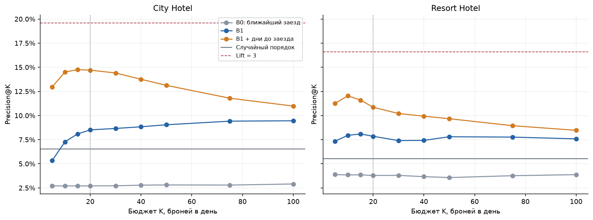
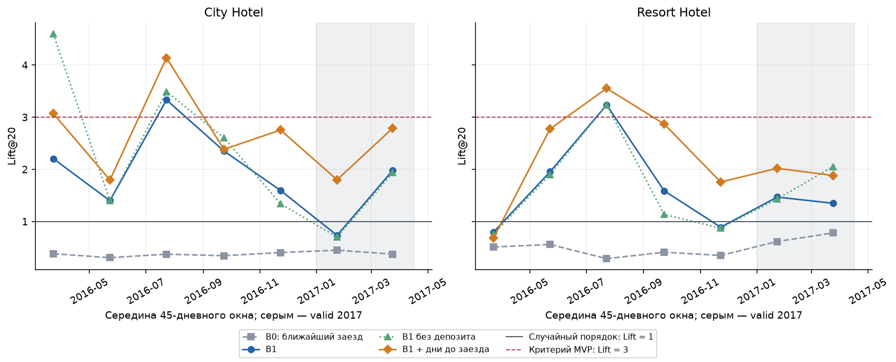

# Бейзлайны B0 и B1 на valid

Числовая опора для критериев этапа 2 [дизайн-документа](../../docs/ml_system_design_doc.md#этап-2-подготовка-прогнозных-моделей). B0 и B1 не требуют обучения модели. B2 (логистическая регрессия) и CatBoost будут в следующей итерации.

## Воспроизведение

```bash
make data
make baselines
# или:
uv run python -m hotel_cancellation.baselines --output-dir reports/baselines
```

Команда пересоздаёт CSV в `tables/`, два PNG и [manifest.json](manifest.json). Случайности нет: «случайный порядок» и равенства оценок внутри дня считаются как математическое ожидание по всем перестановкам, поэтому seed не нужен. Снимки строятся только до 16.04.2017. Если попросить test-период, код падает, это проверяет [тест](../../tests/test_baselines.py). В manifest записано `test_period_scored: false`. **На test не посчитано ни одной метрики.**

## Протокол

- Кандидаты те же, что в EDA: активные брони с заездом через 1–14 дней. Ранжирование идёт отдельно по отелю и дню, K = 20.
- B1 обучается один раз на train-снимках 01.07.2015–17.12.2016. Берутся только исходы, известные до 01.01.2017; исключено 1 122 снимка (339 броней).
- **tune**: 01.01–14.02.2017, исходы известны к 01.03 (исключено 699 снимков, 201 бронь). Здесь выбраны α = 100 из {10, 30, 100} ([сетка](tables/b1_alpha_grid.csv), на City α не влияет) и эталонное правило.
- **calibration**: 01.03–16.04.2017, исходы известны к 01.05 (исключено 827 снимков, 338 броней). Это контрольное окно после выбора: на нём ничего не подбиралось. Проверку зрелости меток записывает [label_maturity.csv](tables/label_maturity.csv).
- **Бэктест**: пять 45-дневных окон 2016 года. Для каждого окна правило обучено на всех более ранних снимках с зазором 14 дней и зрелыми метками.
- Метрики считаются по разделу 2.1 дизайн-документа. Precision@20 и Recall@20 — макросредние по дням. Lift@20 — макро-Precision, делённая на среднюю дневную долю потерь. AP считается по всем снимкам отеля в окне, Brier — для вероятностных правил. Потолок — идеальное ранжирование того же дня.

| Правило | Как ранжирует |
| --- | --- |
| B0: случайный порядок | все кандидаты равны; Lift = 1 по построению |
| B0: ближайший заезд | чем меньше дней до заезда, тем выше; внутри дня порядок случайный. Так, по нашему допущению, работают сейчас |
| B1 | сглаженная доля потерь train-снимков в сегменте «отель × `market_segment` × `deposit_type` × `customer_type` × возраст брони (1–7, 8–30, 31–90, > 90 дней)». Сегмент, в котором меньше 30 уникальных броней, получает долю отеля |
| B1 без депозита | то же без спорного `deposit_type` |
| B1 + дни до заезда | B1 плюс корзина дней до заезда (1–3, 4–7, 8–14). По [feature-level EDA](../eda/README.md#6-признаки-на-снимках-что-несёт-сигнал) это сильнейший признак |

## Результаты на valid

Precision@20 / Lift@20, полные данные — в [baseline_metrics.csv](tables/baseline_metrics.csv):

| Правило | City: tune | City: calibration | Resort: tune | Resort: calibration |
| --- | ---: | ---: | ---: | ---: |
| Кандидатов / будущих потерь в день | 492 / 35,7 | 855 / 50,1 | 297 / 20,2 | 410 / 19,0 |
| B0: случайный порядок | 7,2% / 1,00 | 5,9% / 1,00 | 6,5% / 1,00 | 4,6% / 1,00 |
| B0: ближайший заезд | 3,2% / 0,45 | 2,2% / 0,37 | 4,0% / 0,62 | 3,6% / 0,78 |
| B1 | 5,3% / 0,73 | 11,6% / 1,98 | 9,6% / 1,47 | 6,2% / 1,35 |
| B1 без депозита | 5,1% / 0,70 | 11,3% / 1,93 | 9,3% / 1,43 | 9,4% / 2,05 |
| B1 + дни до заезда | **13,0% / 1,80** | **16,3% / 2,79** | **13,2% / 2,02** | 8,6% / 1,88 |
| Потолок: идеальный порядок | 100% / 13,8 | 100% / 17,1 | 79,8% / 12,2 | 79,9% / 17,4 |

Вспомогательные метрики правила «B1 + дни до заезда»:
- AP: City 0,094 и 0,102 при базовой доле 0,072 и 0,059; Resort 0,104 и 0,091 при 0,065 и 0,046.
- Recall@20: City 7,9% и 6,2% при потолке 64% и 44%; Resort 13,2% и 8,1% при потолке 88% и 90%.



**Выводы.**

1. **Текущая практика хуже случайного порядка** (Lift 0,37–0,78). Брони с заездом завтра почти не успевают отмениться. На train-снимках доля будущих потерь при 1 дне до заезда — 3,7% (City) и 1,9% (Resort), при 14 днях — 13,9% и 8,2%.
2. **B1 из плана HW1 слабый и нестабильный.** В City на tune он хуже случайного порядка. Верх списка там занимает сегмент «Groups / No Deposit / Transient-Party / 8–30 дней». В train у него 23,8% потерь (массовые отмены групп), а у 135 таких броней в январе–феврале 2017 — 1,4%. Сегментное правило переносит групповые события прошлого на новые брони.
3. **Дни до заезда дают лучшее правило на tune в обоих отелях.** Оно выбрано эталоном для критерия «лучше бейзлайна»; в дизайн-документе это **B1+t**. На calibration оно остаётся лучшим в City, а в Resort близко к лучшему: 1,88 против 2,05 у B1 без депозита.
4. **`deposit_type` почти ничего не даёт:** `Non Refund` — лишь 0,3–0,6% снимков. Модель без спорных полей потеряет немного.
5. **Вероятности из train завышены для 2017 года.** В City на tune B1 в среднем прогнозирует 11,5% при фактических 7,2%, Brier на уровне константы (0,072 против 0,068). Перекалибровка на последнем окне обязательна.

## Устойчивость: бэктест 2016 года



В 2016 году Lift@20 правил сильно колеблется между окнами: в City от 1,3 до 4,6, в Resort от 0,7 до 3,6. На valid 2017 года он от 0,7 до 2,8. Lift@20 = 3 лучшее правило достигает в 3 из 10 окон «отель × период» 2016 года и ни разу на valid 2017 года. B0 «ближайший заезд» хуже случайного порядка во всех 14 окнах. Данные — в [backtest.csv](tables/backtest.csv). Блочный bootstrap на 45-дневном окне почти неинформативен (около трёх 14-дневных блоков), поэтому изменчивость показана разбросом между окнами.

## Порядок строк нельзя использовать для разрешения равенств

Внутри дня заезда отменённые брони в CSV идут первыми ([EDA](../eda/README.md#2-качество-данных)). Правило «ближайший заезд» почти целиком состоит из равенств: все завтрашние заезды получают одну оценку. Если брать их по возрастанию номера строки, Lift завышается в 2–3 раза, по убыванию — падает до нуля ([tie_break_leak.csv](tables/tie_break_leak.csv)):

| Разрешение равенств | City: tune | City: calibration | Resort: tune | Resort: calibration |
| --- | ---: | ---: | ---: | ---: |
| Ожидание по случайному порядку (используем) | 0,45 | 0,37 | 0,62 | 0,78 |
| Номер строки по возрастанию | 0,91 | 1,20 | 1,11 | 1,35 |
| Номер строки по убыванию | 0,00 | 0,00 | 0,17 | 0,23 |

## Чувствительность к полным повторам

Удаление полных повторов меняет не только долю цели, но и качество правил: B1 на tune в City вырос с 0,73 до 1,93, «B1 + дни до заезда» — с 1,80 до 2,57; в Resort B1 снизился с 1,47 до 1,21. Популяция при этом меняется: в City в среднем 401 кандидат в день вместо 492. Поэтому сравнивать правила можно только на одинаковых кандидатах: [duplicate_sensitivity.csv](tables/duplicate_sensitivity.csv). Модель будет оцениваться в обоих сценариях.

## Что это значит для критериев

- Порог Lift@20 ≥ 3 не тривиален: ни одно правило не достигает его на valid. Но он и не недостижим: правила превышали 3 в отдельных периодах 2016 года, а потолок — 12–17. Полное обоснование дано в этапе 2 дизайн-документа.
- Сравнивать модель только с B1 из плана было бы слабым требованием. Эталоном становится лучшее правило «B1 + дни до заезда» (B1+t).
- Текущая практика имеет офлайн Lift около 0,4–0,8. Это нужно учитывать при интерпретации критерия пилота «вдвое больше попаданий, чем у контроля».

## Ограничения

- Окна valid короткие (45 и 47 дней). Одна бронь присутствует в списке до 14 дней подряд, и без журнала контактов её будущая отмена засчитывается каждый день.
- Правила обучены на исходных строках: дубли и групповые брони не объединены. Вариант без повторов — проверка чувствительности, а не исправление.
- Снимки — ретроспективная реконструкция, а соглашение о дне отмены оптимистично (см. EDA). Офлайн-оценки — верхняя граница того, что увидит отель.

## Артефакты

- `tables/baseline_metrics.csv` — все метрики по окнам valid, моделям и отелям, включая K = 10, 30, 50, AP, ROC-AUC и Brier.
- `tables/backtest.csv` — бэктест 2016 года; `tables/b1_alpha_grid.csv` — выбор α; `tables/b1_segments.csv` — сегменты B1 с поддержкой.
- `tables/label_maturity.csv`, `tables/duplicate_sensitivity.csv`, `tables/tie_break_leak.csv` — зрелость меток, дубли, разрешение равенств.
- `figures/01_lift_by_window.png`, `figures/02_precision_at_k.png`; [код](../../src/hotel_cancellation/baselines.py) и [метрики](../../src/hotel_cancellation/metrics.py).
