# EDA: риск отмены бронирования отеля

Анализ для домашнего задания №2. Единица исходных данных — строка брони; единица будущего прогноза — **бронь × утро дня**, когда до заезда осталось 1–14 дней. Проверяем данные для ежедневного списка top-20 каждого отеля.

## Воспроизведение и источник

Из корня репозитория после установки зависимостей:

```bash
make data
make eda
# или:
uv run python -m hotel_cancellation.eda --output-dir reports/eda
```

Команда проверяет SHA-256 и заново создаёт CSV в `tables/`, двенадцать PNG в `figures/` и [manifest.json](manifest.json). Этот текстовый отчёт содержит интерпретацию результатов и не перезаписывается командой. Случайные выборки не используются. Данные остаются в игнорируемой папке `data/raw/`; сохраняются только агрегаты. Версии библиотек и контрольная сумма записаны в manifest, зависимости фиксирует `uv.lock`.

Источник: [Hotel Booking Demand, Antonio et al. (2019)](https://pmc.ncbi.nlm.nih.gov/articles/PMC6297060/), [словарь TidyTuesday](https://github.com/rfordatascience/tidytuesday/tree/main/data/2020/2020-02-11). [CSV закреплён на конкретном коммите](https://raw.githubusercontent.com/rfordatascience/tidytuesday/d75aaa0d31596ad6487ae0db20138067d301e031/data/2020/2020-02-11/hotels.csv).

**Что известно о test.** Разделы 1–5 и 7 описывают весь период, включая будущий test (снимки 01.05–17.08.2017). Его доля позитивов, размеры списков и чувствительность к допущениям уже известны, поэтому test нельзя считать полностью нетронутым. Новые части анализа используют только период разработки: брони с заездом до 01.05.2017 и снимки train/valid. Это раздел 6 (признаки на снимках), влияние повторов на признаки и сегменты, проверка порядка строк (рисунки 9–12) и [бейзлайны](../baselines/README.md). Ни одной метрики ранжирования на test не посчитано. Как протокол защищает финальную оценку, описано в этапе 2 [дизайн-документа](../../docs/ml_system_design_doc.md#этап-2-подготовка-прогнозных-моделей).

**Границы достоверности.** Авторы восстанавливали доступные значения из журнала изменений на день перед заездом. CSV не содержит историю состояний на произвольное утро s. Наши снимки — ретроспективное приближение состава кандидатов, а не полноценная point-in-time витрина. Нельзя автоматически считать атрибуты известными при создании брони или на каждом из предшествующих 14 дней.

## 1. Состав, объём и разметка

В CSV **119 390 строк и 32 исходных поля**. Загрузчик добавляет три служебные даты. Заезды: **01.07.2015–31.08.2017**, два отеля Португалии. Это 26 месяцев, но 2015 и 2017 представлены не полностью. `is_canceled=1` объединяет отмену и no-show; общая доля — **37,04%**. Несоответствий этой метки итоговому статусу нет.

| Отель | Строк | Check-Out | Canceled | No-Show | Отмена или no-show |
| --- | ---: | ---: | ---: | ---: | ---: |
| City Hotel | 79 330 | 46 228 | 32 186 | 916 | 41,73% |
| Resort Hotel | 40 060 | 28 938 | 10 831 | 291 | 27,76% |
| Всего | 119 390 | 75 166 | 43 017 | 1 207 | 37,04% |

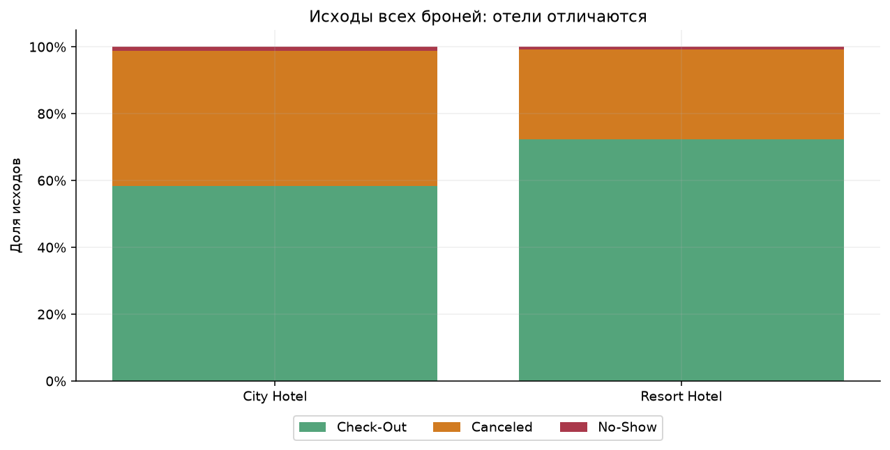

**Вывод.** У отелей разные базовые риски: нужны метрики и top-20 отдельно для каждого. Общая accuracy скроет различия и дисбаланс. No-show — редкий подтип, при моделировании его качество проверяем отдельно от обычных отмен. Данные относятся к двум отелям до пандемии, перенос на другой отель или современный период требует проверки.

[Полный профиль всех 32 полей](tables/field_profile.csv) содержит тип, число заполненных значений, пропуски и число уникальных значений. [Числовой профиль](tables/numeric_profile.csv) содержит минимум, максимум и квантили, включая 1% и 99%. Группы полей: календарь заезда, длительность, гости, канал, депозит, агент/компания, история гостя, изменения брони и исход. Уникальных ID брони/гостя, истории утренних состояний и журнала контактов нет.

## 2. Качество данных

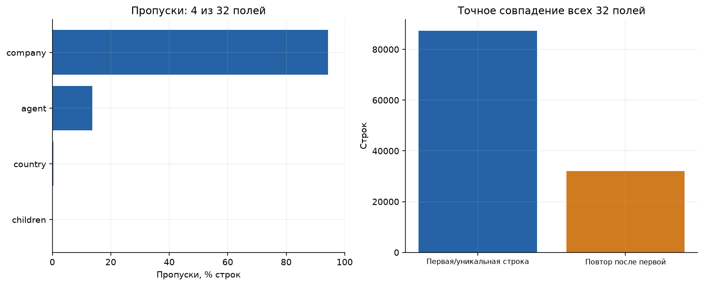

Пропуски есть только в четырёх полях:

| Поле | Пропущено | Доля | Решение для будущей модели |
| --- | ---: | ---: | --- |
| `company` | 112 593 | 94,31% | Отдельная категория отсутствующего посредника, в PMS отличать отсутствие от сбоя выгрузки |
| `agent` | 16 340 | 13,69% | Отдельная категория, ID агента — категориальный, не количественный признак |
| `country` | 488 | 0,41% | Исключено из MVP |
| `children` | 4 | 0,0034% | Флаг пропуска и заполнение внутри train-пайплайна, пропуск не доказывает отсутствие детей |

| Проверка | Строк | Интерпретация и действие |
| --- | ---: | --- |
| ADR < 0 / ADR > 1000 | 1 / 1 | Минимум −6,38, максимум 5 400; проверять первоисточник, сохранять флаг аномалии |
| ADR = 0 | 1 959 | Может быть бесплатная/техническая бронь, не удалять автоматически |
| Нулевое число ночей | 715 | Проверить значение с PMS, сохранить и проверить чувствительность |
| Нулевое число гостей | 180 | При расчёте пропущенные `children` временно приняты за 0 в рамках диагностики |
| `meal = Undefined` | 1 169 | По словарю соответствует SC — без питания |
| `market_segment = Undefined` / `distribution_channel = Undefined` | 2 / 5 | Неизвестная категория, слишком мало строк для надёжных выводов о риске |
| No-show датирован не днём заезда | 1 | Дата статуса 28.03.2016, заезд 17.07.2016: расхождение 111 дней, а не задержка регистрации |
| Полное совпадение 32 полей после первого экземпляра | 31 994 | 26,80% строк, без ID смысл повторов неоднозначен |
| Порядок строк внутри отеля и дня заезда связан с меткой | 97 192 | Заезды до 01.05.2017: в первой пятой части строк дня 76% потерь, в последней 5%, ROC-AUC позиции 0,84. Индекс строки — технический ключ, а не признак |

Нарушений допустимых значений метки, отрицательных длительностей/числа гостей/lead time, отмен до реконструированного создания или после заезда и Check-Out до заезда нет. Все проверки, включая нулевые, воспроизводятся в [quality_checks.csv](tables/quality_checks.csv). Единственная аномальная дата no-show сохранена как в источнике.

**Вывод о порядке строк.** CSV не перемешан: внутри отеля и дня заезда отменённые брони чаще стоят первыми ([row_order_label.csv](tables/row_order_label.csv)). Любая устойчивая сортировка или `head(K)` по исходному порядку незаметно подмешивает метку. Например, правило «ближайший заезд» с разрешением равенств по номеру строки дало бы Lift@20 0,91–1,35 вместо честных 0,37–0,78 ([бейзлайны](../baselines/README.md#порядок-строк-нельзя-использовать-для-разрешения-равенств)). Поэтому метрики проекта считают равенства в ожидании по случайному порядку, а индекс строки не используется для сортировки и не входит в признаки.

**Вывод о датах.** `booking_date = arrival_date − lead_time` — реконструкция, переносы заезда и история изменения lead time не наблюдаются. Отсутствие противоречий порядка дат не доказывает точность утреннего состояния.

**Вывод о повторах.** Они могут быть и техническими дублями, и разными одинаковыми бронями группы. Основной анализ сохраняет строки. Удаление полных повторов оставляет 87 396 строк и меняет распределение цели:

| Отель | Все строки: доля потерь | После удаления повторов | Доля в test-снимках: все / без повторов |
| --- | ---: | ---: | ---: |
| City Hotel | 41,73% | 30,04% | 4,82% / 4,68% |
| Resort Hotel | 27,76% | 23,48% | 4,41% / 4,12% |

[duplicate_sensitivity.csv](tables/duplicate_sensitivity.csv) содержит размеры и частоты обоих сценариев. Механическая дедупликация меняет бизнес-популяцию. Нужны booking_id и group_id, а также устойчивость будущих моделей к обеим трактовкам.

**Повторы меняют признаки и сегменты, а не только долю цели.** Ниже расчёт по 97 192 броням с заездом до 01.05.2017 и по train-снимкам ([duplicate_composition.csv](tables/duplicate_composition.csv), [duplicate_numeric_shift.csv](tables/duplicate_numeric_shift.csv)):

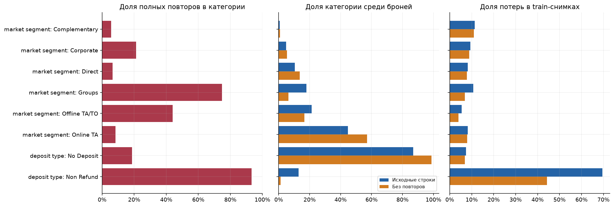

| Что меняется | Все строки | Без полных повторов |
| --- | ---: | ---: |
| Доля `Groups` / `Non Refund` среди броней | 18,0% / 12,9% | 6,3% / 1,2% |
| Доля `Online TA` / `Transient-Party` среди броней | 44,7% / 23,0% | 57,1% / 14,7% |
| `lead_time`: среднее / медиана, дней | 96,7 / 60 | 70,2 / 41 |
| Доля потерь `Groups` / `Offline TA/TO` среди броней | 60,2% / 34,4% | 25,9% / 13,8% |
| Доля потерь `Groups` / `Non Refund` в train-снимках | 10,7% / 69,5% | 6,9% / 44,3% |
| ROC-AUC `deposit_type` / `customer_type` на снимках (раздел 6) | 0,525 / 0,474 | 0,502 / 0,530 |
| Lift@20 правила B1 в City на tune ([бейзлайны](../baselines/README.md)) | 0,73 | 1,93 |

Повторы — это 75% строк `Groups`, 44% `Offline TA/TO` и 93% `Non Refund`, а также 49% отменённых броней против 16% состоявшихся. Удалённые строки отличаются по признакам. У них длиннее `lead_time`: 164 дня против 70 в среднем, стандартизованная разность 0,88. Меньше особых пожеланий (−0,69), детей (−0,37) и изменений брони (−0,34). Значит, повторы — в основном групповые и пакетные брони турагентов, а не случайный шум. Дедупликация убирает почти весь `Non Refund`, ослабляет связь депозита с целью и меняет качество сегментных правил. **Решение:** основной анализ сохраняет строки, т.к. без ID нельзя доказать, что это дубли. Но каждый бейзлайн и каждая модель оцениваются в обеих популяциях, а сегменты, где доминирует одна группа, проверяются отдельно (БТ-8).

## 3. Время, сезонность и числовые признаки

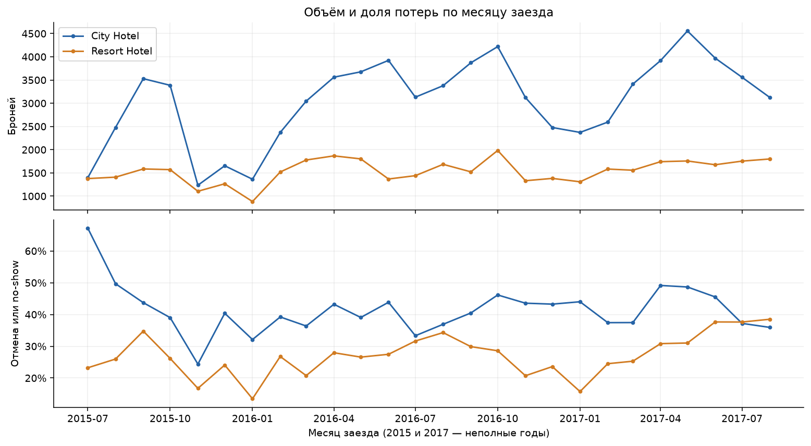

**Вывод.** Объём и доля отмен меняются по месяцам и различаются по отелям. Наблюдаемая волатильность City Hotel выше, включая скачок доли потерь летом 2015 года. История ограничена 26 месяцами и лишь одним полным календарным годом, её недостаточно, чтобы надёжно отделить сезонность от изменений каналов, групповых броней и политик. Случайное разбиение смешает прошлое и будущее, используем временную валидацию. Точные агрегаты — [monthly_bookings.csv](tables/monthly_bookings.csv).

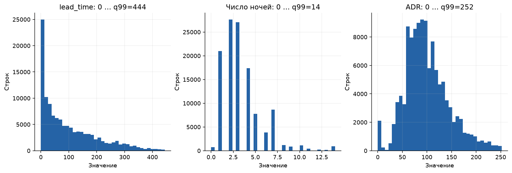

**Вывод.** `lead_time`, число ночей и ADR имеют длинные правые хвосты. Для читаемости рисунок показывает значения от 0 до q99, это не очистка исходных данных:

| Признак | q99, граница рисунка | Полный диапазон | Не показано строк |
| --- | ---: | --- | ---: |
| `lead_time` | 444 дня | 0–737 | 1 178 |
| Число ночей | 14 | 0–69 | 439 |
| ADR | 252 | −6,38–5 400 | 1 169 |

Все значения сохранены в расчётах. Границы обработки выбросов для модели обучаются только на train. Нужны сравнение с исходными значениями и флаги аномалий, нулевой ADR не равен ошибке. Таблица: [histogram_bounds.csv](tables/histogram_bounds.csv).

## 4. Когда отменяют

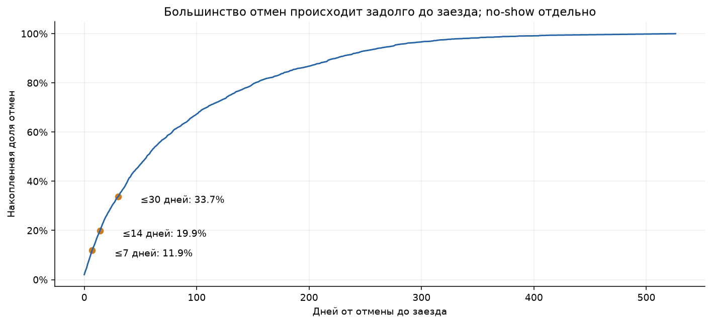

Медиана от отмены до заезда — **56 дней**. На рисунке по оси y — доля отмен, произошедших за указанное число дней или ближе к заезду, знаменатель — 43 017 записей `Canceled`, без no-show.

| Отмена не раньше чем за… | Строк | Доля всех отмен |
| --- | ---: | ---: |
| 7 дней | 5 135 | 11,94% |
| 14 дней | 8 576 | 19,94% |
| 30 дней | 14 502 | 33,71% |

**Вывод.** Большинство отмен случается раньше рабочего окна H=14. Они важны для политики бронирования, но не должны попадать в утренний список уже отменёнными. Цель списка — будущая потеря среди ещё активных броней, общие 37% неприменимы к этому списку. Данные: [cancellation_timing.csv](tables/cancellation_timing.csv).

ADR × ночи — лишь валовая стоимость брони, а не доказанный ущерб: перепродажа, штрафы и маржинальность неизвестны. Кроме того, ADR получен из транзакций, его историческое значение на утро скоринга в CSV не гарантировано.

## 5. Категории и смена связи признаков с целью

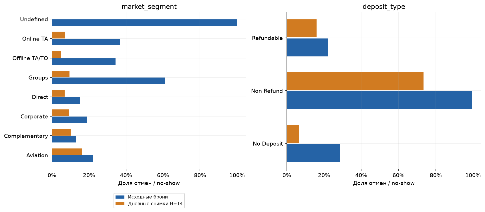

**Вывод.** Частота потерь связана с каналом и депозитом, но меняется после ограничения активными бронями. Высокий риск `Non Refund` нельзя считать причинным эффектом депозита: возможны групповые брони, договорные особенности и общие отмены. Для малочисленных категорий проверяем поддержку, например, у `Undefined` всего две исходные строки, поэтому надёжное правило по ним получить нельзя. Отсутствующий столбик для категории означает отсутствие наблюдений в этой популяции, а не оценку нулевого риска.

На рисунке отели объединены только для обзора, [categorical_rates.csv](tables/categorical_rates.csv) содержит число наблюдений, позитивов и частоту каждого значения отдельно по отелю и популяции. У снимков одна бронь повторяется до 14 раз, поэтому обычные биномиальные интервалы по независимым строкам некорректны.

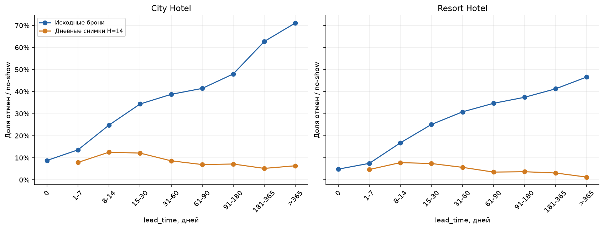

ROC-AUC одного исходного `lead_time`: **0,689** по всем броням и **0,414** по дневным снимкам. Это описательная статистика всего периода, не качество обученной модели и не метрика на отложенном наборе. Частоты и размеры корзин — [lead_time_rates.csv](tables/lead_time_rates.csv), AUC — [single_feature_auc.csv](tables/single_feature_auc.csv). Категория lead time = 0 отсутствует среди утренних снимков: бронь должна быть создана до дня s.

**Вывод.** Связь может менять знак после отбора доживших до последних 14 дней броней. Большой lead time среди ещё активных броней не равнозначен высокому текущему риску. Бейзлайн исторической доли отмен необходимо считать на снимках train, а не на всех исходных бронях. Признаки `days_to_arrival` и `days_since_booking` полезны при проверенной дате создания.

## 6. Признаки на снимках: что несёт сигнал

В разделе 5 видно, что связь `lead_time` с целью меняет знак после перехода к снимкам. Здесь та же проверка выполнена для всех полей. Для каждого признака по train-снимкам (01.07.2015–17.12.2016, исходы известны до 01.01.2017) строится одномерная таблица: сглаженная доля потерь категории или дециля. Затем считается ROC-AUC этой таблицы на valid-снимках (01.01–16.04.2017, исходы известны до 01.05.2017). Расчёт идёт отдельно в каждом отеле, результат усредняется. Так измеряется сигнал, который переносится во времени и работает внутри отеля, как ранжирование, а не подгонка под train. Та же процедура на исходных бронях (обучение на заездах до конца 2016 года, проверка на январе–апреле 2017) даёт точки для сравнения.

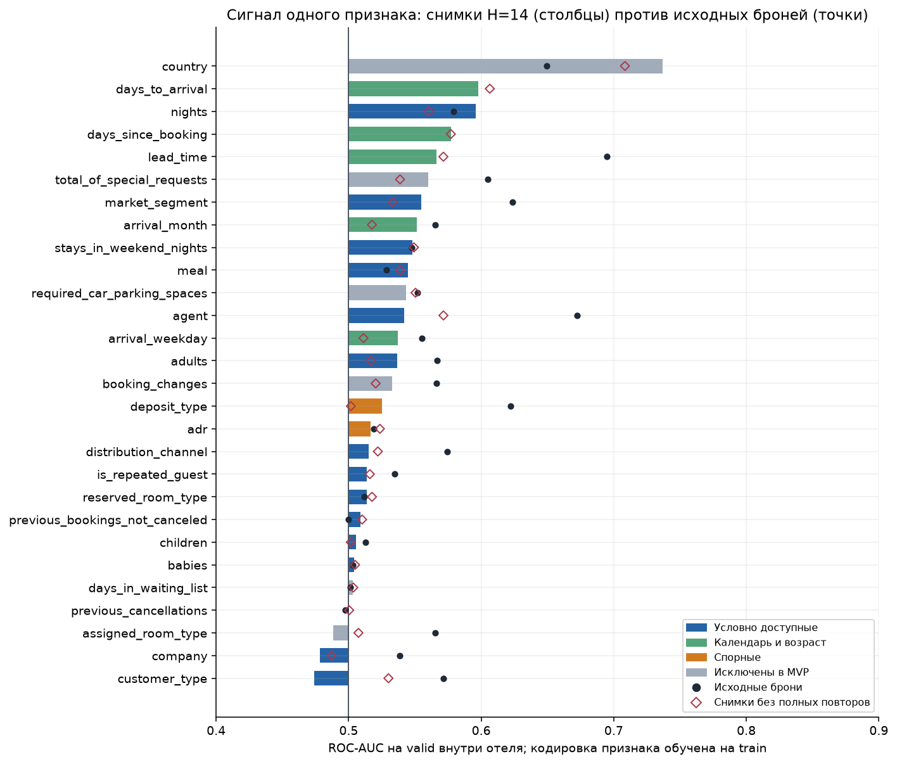

| Признак | Группа доступности | Брони | Снимки | Снимки без повторов | Направление связи |
| --- | --- | ---: | ---: | ---: | --- |
| `country` | исключён | 0,649 | 0,737 | 0,708 | у PRT 17,3% потерь против 4,2% (train-снимки) |
| `days_to_arrival` | календарь | — | 0,598 | 0,606 | больше дней до заезда → выше риск |
| `nights` | условно доступен | 0,579 | 0,596 | 0,560 | меняется: на снимках выше всего риск у одной ночи |
| `days_since_booking` | возраст | — | 0,577 | 0,577 | свежие брони рискованнее |
| `lead_time` | календарь | 0,695 | 0,566 | 0,571 | меняет знак: сырое значение 0,697 → 0,422 |
| `market_segment` | условно доступен | 0,623 | 0,555 | 0,533 | |
| `arrival_month` | календарь | 0,565 | 0,552 | 0,518 | |
| `agent` | условно доступен | 0,673 | 0,542 | 0,571 | |
| `deposit_type` | спорный | 0,622 | 0,525 | 0,502 | без повторов сигнала нет |
| `adr` | спорный | 0,519 | 0,516 | 0,524 | слабая, немонотонная |
| `previous_cancellations` | спорный | 0,498 | 0,500 | 0,500 | связь из train не переносится на valid |
| `customer_type` | условно доступен | 0,572 | 0,474 | 0,530 | на valid обратная train |

Все 28 полей и сырые AUC числовых признаков — в [feature_signal.csv](tables/feature_signal.csv). AUC ниже 0,5 значит, что упорядочение, выученное на train, на valid работает в обратную сторону.

**Выводы.**

1. **Сигнал на снимках несут прежде всего время и возраст брони.** Доля будущих потерь растёт с числом дней до заезда: с 3,7% (City) и 1,9% (Resort) за 1 день до 13,9% и 8,2% за 14 дней. Свежие брони рискованнее старых: при возрасте 1–7 дней 14,5% и 7,9%, при 181–365 днях 5,3% и 3,2%. Дальше идут длительность проживания (у одной ночи 14,4% и 7,9%), сегмент, месяц, питание и агент. Эти сигналы сохраняются и без повторов.
2. **Каждый признак по отдельности слаб.** Лучший допустимый признак даёт AUC 0,60. Признаки бронирования (агент, сегмент, депозит, канал) хорошо предсказывали ранние отмены, но на снимках их сигнал заметно меньше: таких отмен в рабочем списке уже нет. Для Lift@20 ≥ 3 модели придётся объединять много слабых сигналов. Бейзлайн B1 по одному сегменту этого не делает.
3. **`lead_time` на снимке почти совпадает с возрастом брони** (Спирмен 0,996), потому что до заезда остаётся всего 1–14 дней. Знак связи меняется из-за отбора: бронь, которая давно создана и всё ещё активна, уже пережила период частых отмен.
4. **Спорные поля дают на снимках мало переносимого сигнала:** у `deposit_type` 0,525 (без повторов 0,502), у `adr` 0,516, у `previous_cancellations` 0,500. Модель без них потеряет немного, а их исключение снижает риск утечки.
5. **`customer_type` и `company` на valid работают в обратную сторону** (0,474 и 0,478). Без повторов `customer_type` даёт 0,530: его связь с целью на train создали групповые повторы. Для таких полей нужны объединение редких категорий и проверка по периодам.
6. **`country` — сильнейший признак на снимках (0,737).** Это согласуется с гипотезой, что страна уточнялась при заезде, а у отменённых броней оставалось исходное значение. Источник этого не подтверждает. Поэтому сильный сигнал — повод проверить доступность поля, а не вернуть его в модель. `country` остаётся исключённым, в том числе из-за риска неравного обращения с гостями.

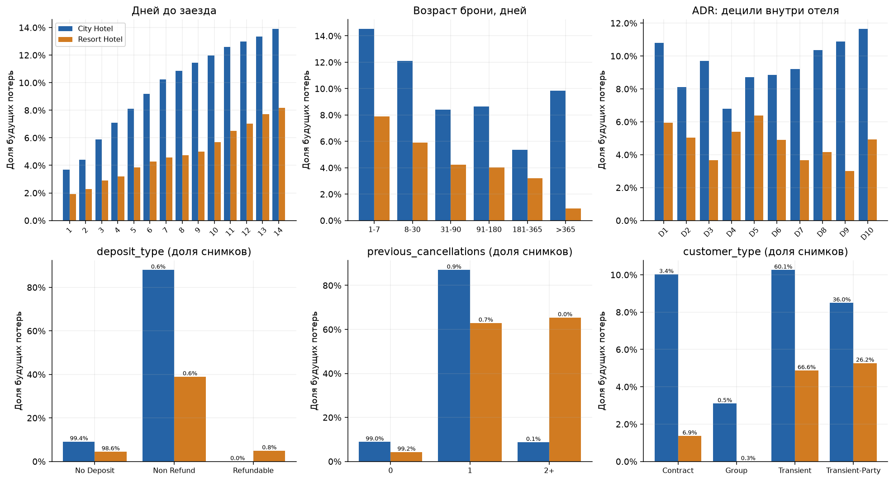

**Признаки, которые требуют отдельной проверки** ([snapshot_feature_rates.csv](tables/snapshot_feature_rates.csv)):

- **`adr`** связан с целью слабо и немонотонно. В City доля потерь по децилям ADR внутри отеля — от 6,8% до 11,6%: дешёвые и дорогие брони рискованнее средних. В Resort — от 3,0% до 6,4% без тренда. ADR зависит от сезона, типа номера и числа гостей, поэтому его вклад оцениваем вместе с месяцем.
- **`deposit_type`.** У `Non Refund` на train-снимках 88,0% потерь в City и 39,0% в Resort, но это лишь 0,6% снимков. На исходных бронях доли 99,8% и 96,0%. Признак может поднять в топ отдельные брони, но почти не влияет на порядок остальных 99%.
- **`previous_cancellations`.** При значении 1 доля потерь 87,0% и 62,9% на 0,9% и 0,7% снимков; при значении 2+ в City всего 8,7%, то есть зависимость немонотонна. В valid у броней с `previous_cancellations > 0` будущих потерь 6,6%, на уровне средней доли. Спирмен с меткой на train +0,23 — максимум среди числовых полей, но связь не переносится на следующий период.
- **`customer_type`.** В City у Contract и Transient 10,0% и 10,3% потерь, у Group 3,1%; в Resort у Contract 1,4%. Отели сильно различаются, поэтому признак используется только вместе с `hotel`.

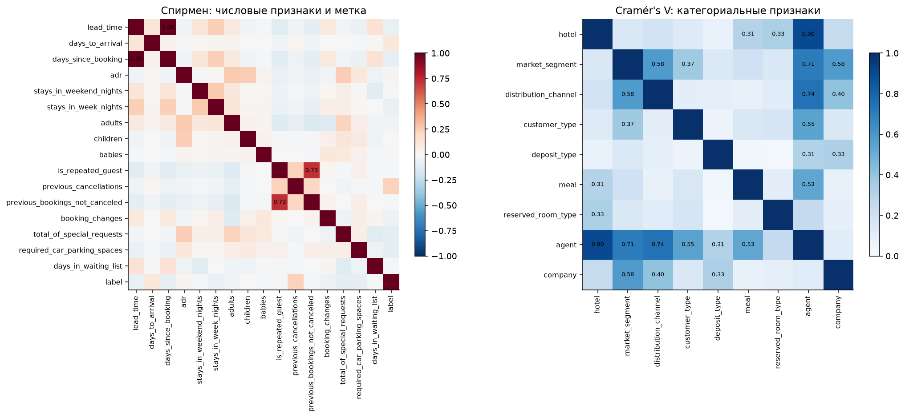

**Корреляции и мультиколлинеарность.**

- **Точная линейная зависимость.** На снимке `lead_time = days_to_arrival + days_since_booking`, и VIF всех трёх признаков бесконечен ([feature_vif.csv](tables/feature_vif.csv)). В линейной модели B2 остаются `days_to_arrival` и `days_since_booking`, а `lead_time` не включается. Без него VIF числовых признаков не выше 1,52, то есть другой мультиколлинеарности среди чисел нет.
- **Числовые пары.** `is_repeated_guest` и `previous_bookings_not_canceled` связаны (Спирмен 0,73). Для остальных пар числовых признаков |ρ| ≤ 0,27 ([feature_spearman.csv](tables/feature_spearman.csv)).
- **Категориальные поля связаны сильнее.** `agent` почти определяет отель (Cramér's V 0,90), канал (0,74) и сегмент (0,71). У пар `market_segment`–`distribution_channel` и `market_segment`–`company` V = 0,58 ([feature_cramers_v.csv](tables/feature_cramers_v.csv)). Для B2 это означает one-hot с L2 и объединение редких агентов. В объяснениях SHAP вклад канала, сегмента и агента показываем вместе, иначе причина риска будет случайно делиться между связанными полями.
- **Связь с меткой слабая.** Кроме `previous_cancellations` (+0,23, не переносится на valid), сильнее всего с меткой связаны `days_to_arrival` (+0,10), `total_of_special_requests` (−0,095) и `days_since_booking` (−0,08). Линейные корреляции ничего не говорят о взаимодействиях, поэтому выбор модели остаётся за сравнением B2 и CatBoost.

## 7. Дневные снимки и временная валидация

Снимок дня s содержит бронь, созданную **до s**, с заездом в **s+1 … s+14** и без отмены **до s**. Время отмены внутри дня неизвестно: основная реконструкция включает день отмены, считая событие произошедшим после утреннего скоринга. Это оптимистичное допущение, не факт исходных данных.

Если исключить все отмены в день s, доля будущих потерь в test меняется: City Hotel **4,82% → 4,22%**, Resort Hotel **4,41% → 3,88%**. [Таблица чувствительности](tables/cancellation_day_sensitivity.csv). В PMS нужны timestamp и единая временная зона, чтобы восстановить настоящий утренний состав.

Всего построено **856 226 снимков из 74 286 исходных строк**. Одна бронь повторяется до 14 раз, количество снимков не равно числу независимых примеров. В общем EDA показаны и интервалы зазоров между сплитами, в обучение/оценку они не входят.

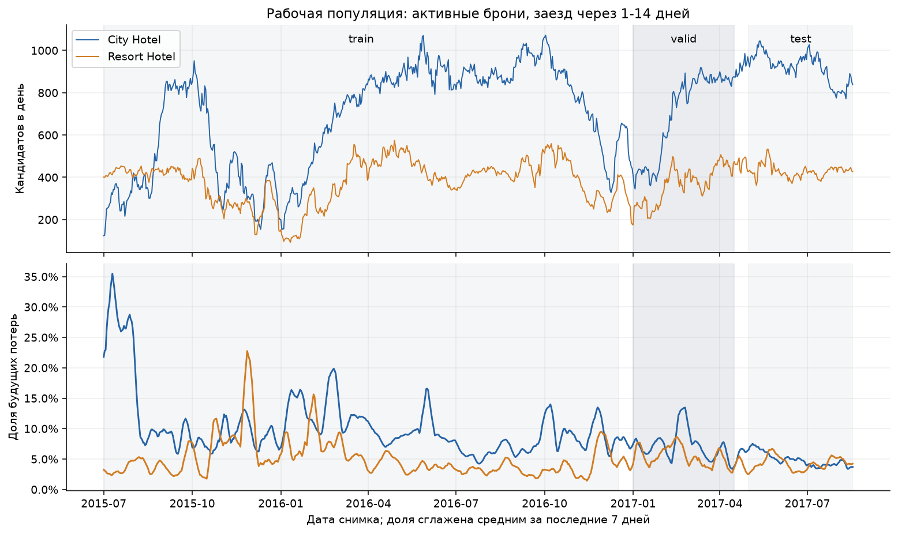

| Часть | Дни снимков | Снимков | Исходных строк | Доля позитивов |
| --- | --- | ---: | ---: | ---: |
| train | 01.07.2015–17.12.2016 | 564 158 | 49 543 | 7,81% |
| valid | 01.01.2017–16.04.2017 | 113 164 | 10 993 | 6,51% |
| test | 01.05.2017–17.08.2017 | 146 921 | 13 161 | 4,69% |

| Отель | Train: снимков / позитивов | Valid: снимков / позитивов | Test: снимков / позитивов |
| --- | --- | --- | --- |
| City Hotel | 360 477 / 9,56% | 74 367 / 7,07% | 100 198 / 4,82% |
| Resort Hotel | 203 681 / 4,71% | 38 797 / 5,44% | 46 723 / 4,41% |

Доли рассчитаны по **снимкам**, число исходных строк — по индексу CSV, а не подтверждённому ID бизнес-брони. [Полная таблица](tables/split_summary.csv) содержит число позитивов, средний размер списка и дни без позитивов/с <20 кандидатами, последних в этих сплитах нет. [Пересечения индексов строк](tables/split_overlap.csv) между сплитами нулевые. Это не гарантирует независимость разных броней одной группы/гостя без их ID.

В test средний список City Hotel содержит **919 кандидатов и 44 будущие потери**, Resort Hotel — **429 и 19**. Список top-20 покрывает лишь небольшую часть доступных броней, поэтому важна точность в верхней части ранжирования. Частоты по месяцам снимков — [monthly_snapshots.csv](tables/monthly_snapshots.csv), дневные агрегаты — [daily_lists.csv](tables/daily_lists.csv).

**Вывод о сдвиге.** В City Hotel частота потерь существенно снижается к позднему периоду; в Resort Hotel изменение не монотонно. Проверяем калибровку и ошибки по каждому отелю и месяцу. Различаем среднюю по дням частоту и долю по всем снимкам, нельзя подставлять взвешенную частоту из этой таблицы в другую формулу Lift.

### Созревание меток: зазора H недостаточно

Статус `Check-Out` подтверждает неотменённую бронь после выезда, отдельного события check-in в CSV нет. Для строгой оценки считаем метку доступной, только если `reservation_status_date < fit_cutoff`. Проверка [label_readiness.csv](tables/label_readiness.csv) выявила:

| Часть | Cutoff | Метка ещё недоступна: броней / снимков | Остаётся зрелых броней / снимков |
| --- | --- | --- | --- |
| train | 01.01.2017 | 339 / 1 122 | 49 204 / 563 036 |
| valid | 01.05.2017 | 338 / 827 | 10 655 / 112 337 |

Все эти строки относятся к Check-Out. Таблицы EDA выше намеренно описывают исходные сплиты HW1 до фильтра зрелости. Для обучения, ранней остановки, подбора и калибровки необходима отдельная фильтрация по фактическому cutoff каждого эксперимента. Вариант «метка известна при заезде» допустим только с реальным событием check-in. Дата отрицательной метки и лаг загрузки должны входить в контракт PMS.

### Чувствительность к горизонту

Чтобы не смешивать эффект H с разными правыми границами данных, [horizon_sensitivity.csv](tables/horizon_sensitivity.csv) сравнивает все горизонты на **одних днях 01.05–01.08.2017**:

| H | City: кандидатов / доля потерь | Resort: кандидатов / доля потерь |
| ---: | --- | --- |
| 7 | 479 / 3,15% | 221 / 3,40% |
| 14 | 936 / 4,94% | 427 / 4,41% |
| 30 | 1 919 / 8,03% | 877 / 6,85% |

**Вывод.** При росте H растут нагрузка и частота цели, но добавляются ранние отмены, на которые контакт может не влиять. H выбираем по бизнес-сценарию и валидации, а не по максимуму доли позитивов.

## 8. Доступность признаков и конфиденциальность

| Поля / данные | Решение и причина |
| --- | --- |
| `is_canceled`, `reservation_status`, `reservation_status_date` | Только метка и построение снимков, итоговые события нельзя использовать как признаки |
| `assigned_room_type` | Исключить: фактическое назначение может появиться после решения |
| `booking_changes`, `total_of_special_requests`, `required_car_parking_spaces`, `country` | Не брать итоговые значения без истории изменений, страна дополнительно исключена по продуктовому решению |
| ADR, депозит, даты, длительность, гости, канал, агент/компания и история гостя | Условно допустимы лишь как значения на утро s, CSV не доказывает их неизменность |
| `days_in_waiting_list` | Итоговое время ожидания может быть неизвестно при раннем прогнозе, исключить либо восстановить на дату |
| Агрегаты отмен агента / сегмента | Только прошлые созревшие метки, нельзя считать по всему CSV |
| Журнал контактов, booking_id, group_id, история состояний | Отсутствуют, обязательны для пилота, дедупликации и исключения повторных звонков |

Сильная связь парковки, назначенного номера или страны с меткой — сигнал для проверки, но не доказательство утечки. Главный критерий — доступность значения в момент решения. Даже исключение подозрительных полей не делает остальные поля гарантированно доступными. Результат на этой выгрузке остаётся ретроспективным прототипом, нужны история версий и сверка с реальными утренними выгрузками.

Публичный CSV не содержит имени, телефона, e-mail или платёжных реквизитов, ID посредников обезличены авторами. Страна, даты и редкие сочетания характеристик всё равно требуют осторожности при присоединении внешних данных. Для PMS контакты хранятся отдельно от ML-витрины с ограничением доступа, в Git и агрегатные отчёты их не переносим. Отсутствие прямых идентификаторов не является гарантией невозможности повторной идентификации.

## 9. Решения для следующего этапа

1. Зафиксировать схему, правила качества, источник времени события/загрузки и список допустимых as-of признаков. Сохранить исходные строки; сравнить обработку повторов, аномалий и дня отмены. Индекс строки CSV не использовать для сортировки, разрешения равенств и как признак.
2. B0 и B1 уже посчитаны на valid и бэктестах 2016 года ([отчёт](../baselines/README.md)). Текущая практика хуже случайного порядка, лучшее правило — B1 с корзиной дней до заезда (Lift@20 1,8–2,8 на valid). Следующие шаги — B2 и CatBoost. B2 — логистическая регрессия на `days_to_arrival` и `days_since_booking` без `lead_time`, one-hot с L2 и объединение редких агентов. Все преобразования и целевые статистики обучаются только на train, с проверкой зрелости меток.
3. Для бюджета K=20 оценивать Precision@20, Recall@20, Lift@20, AP/PR-AUC, дополнительно Brier и калибровку; отдельно по отелям, месяцам, каналам и no-show. Доверительные интервалы — блоками дней/недель, а не по независимым строкам.
4. Разделить подбор параметров и калибровку внутри исторического периода; заморозить протокол до итоговой оценки. Не улучшать модель по уже просмотренному `test`. Новые анализы и бейзлайны test-период не используют; для внешней проверки нужны новые данные.
5. До пилота получить timestamp событий и реальные утренние состояния хотя бы за полный сезонный цикл, предпочтительно два. Дополнительный объём обосновывать числом независимых потерь, learning curve и мощностью пилота, а не числом размноженных снимков. Публичных данных достаточно для учебного сравнения подходов, но недостаточно для подтверждения production-эффекта.
6. Проверить контактность каналов, повторные контакты и групповые брони с отелем. Сам факт предсказания отмены не доказывает, что звонок её предотвратит: нужен контролируемый пилот и журнал вмешательств.
7. Спорные поля (`adr`, `deposit_type`, `previous_cancellations`) дают мало переносимого сигнала. Основную модель сравнить с вариантом без них. Каждую модель оценивать и на популяции без полных повторов и проверять, не занимает ли верх списка одна группа.

Подробные этапы, функции потерь, протокол валидации и критерии готовности — в [дизайн-документе](../../docs/ml_system_design_doc.md#23-этапы-решения-задачи).

## Артефакты

- `figures/01_quality.png` … `12_duplicates.png` — двенадцать рисунков, все показаны выше с выводами.
- `tables/field_profile.csv`, `numeric_profile.csv`, `quality_checks.csv`, `outcomes.csv` — состав, разметка и качество.
- `tables/monthly_bookings.csv`, `monthly_snapshots.csv`, `daily_lists.csv` — временные агрегаты.
- `tables/categorical_rates.csv`, `lead_time_rates.csv`, `single_feature_auc.csv`, `histogram_bounds.csv`, `cancellation_timing.csv` — признаки и время отмены.
- `tables/split_summary.csv`, `split_overlap.csv`, `label_readiness.csv` — размеры, независимость строк и зрелость меток.
- `tables/duplicate_sensitivity.csv`, `cancellation_day_sensitivity.csv`, `horizon_sensitivity.csv` — чувствительность к допущениям.
- `tables/feature_signal.csv`, `snapshot_feature_rates.csv` — сигнал признаков на снимках и доли потерь по значениям.
- `tables/feature_spearman.csv`, `feature_vif.csv`, `feature_cramers_v.csv` — корреляции и мультиколлинеарность.
- `tables/duplicate_composition.csv`, `duplicate_numeric_shift.csv`, `row_order_label.csv` — повторы по признакам и сегментам, связь порядка строк с меткой.
- Исходный код: [eda.py](../../src/hotel_cancellation/eda.py), [feature_eda.py](../../src/hotel_cancellation/feature_eda.py); [manifest](manifest.json) — воспроизведение.
